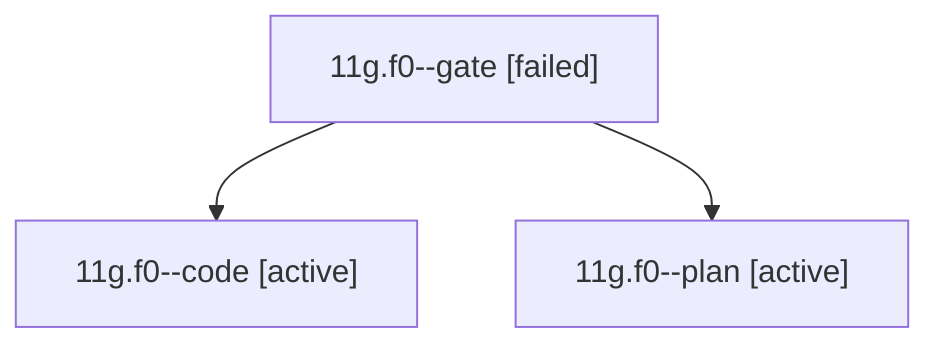

# Session: 11g.f0

[Agent Hoods](../README.md) / [bbugyi200](../users/bbugyi200/README.md) / [athena](../users/bbugyi200/machines/athena/README.md) / [11g](../users/bbugyi200/machines/athena/hoods/11g/README.md) / 11g.f0

Owner: `bbugyi200.athena` · Hood: `11g` · Members: 3

## Lineage

The diagram is an optional enhancement; the ordered table below contains the same lineage in accessible text.

| Role | Agent | State | Model / provider | Timing | Commits | Prompt | Chat |
|---|---|---|---|---|---:|---|---|
| gate | 11g.f0--gate | failed | opus / claude | 2026-10-18T18:06:39.322590+00:00 → 2026-10-18T18:07:08.971648+00:00 | 0 | — | [Chat](../agents/bbugyi200.athena.11g.f0--gate/chat.md) |
| code | 11g.f0--code | active | gpt-6-luna / codex | 2026-10-18T18:07:37.007166+00:00 | 0 | — | — |
| plan | 11g.f0--plan | active | opus / claude | 2026-10-18T17:53:43.517267+00:00 | 0 | [Prompt](../agents/bbugyi200.athena.11g.f0--plan/prompt.md) | [Chat](../agents/bbugyi200.athena.11g.f0--plan/chat.md) |

## Neighbors

| Agent | Relation | State |
|---|---|---|
| [11g](bbugyi200.athena.11g.md) (session · 3) | ancestor | completed 2, failed 1 |
