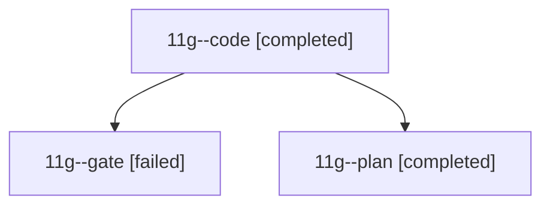

# Session: 11g

[Agent Hoods](../README.md) / [bbugyi200](../users/bbugyi200/README.md) / [athena](../users/bbugyi200/machines/athena/README.md) / [11g](../users/bbugyi200/machines/athena/hoods/11g/README.md) / 11g

Owner: `bbugyi200.athena` · Hood: `11g` · Members: 3

## Lineage

The diagram is an optional enhancement; the ordered table below contains the same lineage in accessible text.

| Role | Agent | State | Model / provider | Timing | Commits | Prompt | Chat |
|---|---|---|---|---|---:|---|---|
| code | 11g--code | completed | sonnet / claude | 2026-10-18T17:34:59.356911+00:00 → 2026-10-18T17:41:52.754050+00:00 | [1](../agents/bbugyi200.athena.11g--code/README.md#commits) | — | [Chat](../agents/bbugyi200.athena.11g--code/chat.md) |
| gate | 11g--gate | failed | opus / claude | 2026-10-18T17:34:09.669508+00:00 → 2026-10-18T17:34:36.890201+00:00 | 0 | — | [Chat](../agents/bbugyi200.athena.11g--gate/chat.md) |
| plan | 11g--plan | completed | opus / claude | 2026-10-18T17:29:46.787078+00:00 → 2026-10-18T17:41:52.754050+00:00 | 0 | [Prompt](../agents/bbugyi200.athena.11g--plan/prompt.md) | [Chat](../agents/bbugyi200.athena.11g--plan/chat.md) |

## Commits

| Role | Repo | Commit | Subject | Committed |
|---|---|---|---|---|
| code | — | `674c9f5` | docs(work-badges): retune color thresholds to 40/60/80 | 2026-10-18 13:39:26 EDT |

## Neighbors

| Agent | Relation | State |
|---|---|---|
| [11g.f0](bbugyi200.athena.11g.f0.md) (session · 3) | descendant | active 1, completed 1, failed 1 |
