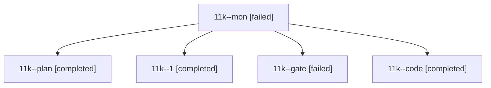

# Session: 11k

[Agent Hoods](../README.md) / [bbugyi200](../users/bbugyi200/README.md) / [athena](../users/bbugyi200/machines/athena/README.md) / [11k](../users/bbugyi200/machines/athena/hoods/11k/README.md) / 11k

Owner: `bbugyi200.athena` · Hood: `11k` · Members: 5

## Lineage

The diagram is an optional enhancement; the ordered table below contains the same lineage in accessible text.

| Role | Agent | State | Model / provider | Timing | Commits | Prompt | Chat |
|---|---|---|---|---|---:|---|---|
| mon | 11k--mon | failed | grok-4.6 / grok | 2026-10-18T20:49:22.780432+00:00 → 2026-10-18T20:53:06.264318+00:00 | 0 | — | [Chat](../agents/bbugyi200.athena.11k--mon/chat.md) |
| plan | 11k--plan | completed | opus / claude | 2026-10-18T19:59:53.016500+00:00 → 2026-10-18T20:16:22.869845+00:00 | 0 | [Prompt](../agents/bbugyi200.athena.11k--plan/prompt.md) | [Chat](../agents/bbugyi200.athena.11k--plan/chat.md) |
| 1 | 11k--1 | completed | grok-4.6 / grok | 2026-10-18T21:01:05.811122+00:00 → 2026-10-18T21:09:16.215050+00:00 | [1](../agents/bbugyi200.athena.11k--1/README.md#commits) | [Prompt](../agents/bbugyi200.athena.11k--1/prompt.md) | — |
| gate | 11k--gate | failed | opus / claude | 2026-10-18T20:15:52.527399+00:00 → 2026-10-18T20:17:33.555654+00:00 | 0 | — | [Chat](../agents/bbugyi200.athena.11k--gate/chat.md) |
| code | 11k--code | completed | grok-4.6 / grok | 2026-10-18T20:18:22.719099+00:00 → 2026-10-18T20:50:53.280819+00:00 | 0 | [Prompt](../agents/bbugyi200.athena.11k--code/prompt.md) | [Chat](../agents/bbugyi200.athena.11k--code/chat.md) |

## Commits

| Role | Repo | Commit | Subject | Committed |
|---|---|---|---|---|
| 1 | — | `8241342` | feat(highlights): copy pasted screenshot paths into ref notes | 2026-10-18 17:07:12 EDT |
