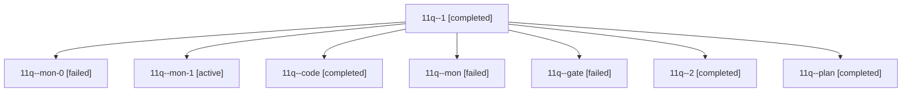

# Session: 11q

[Agent Hoods](../README.md) / [bbugyi200](../users/bbugyi200/README.md) / [athena](../users/bbugyi200/machines/athena/README.md) / [11q](../users/bbugyi200/machines/athena/hoods/11q/README.md) / 11q

Owner: `bbugyi200.athena` · Hood: `11q` · Members: 8

## Lineage

The diagram is an optional enhancement; the ordered table below contains the same lineage in accessible text.

| Role | Agent | State | Model / provider | Timing | Commits | Prompt | Chat |
|---|---|---|---|---|---:|---|---|
| 1 | 11q--1 | completed | gpt-6-luna / codex | 2026-10-19T14:00:56.649968+00:00 → 2026-10-19T14:06:22.079949+00:00 | 0 | [Prompt](../agents/bbugyi200.athena.11q--1/prompt.md) | [Chat](../agents/bbugyi200.athena.11q--1/chat.md) |
| mon-0 | 11q--mon-0 | failed | gpt-6-luna / codex | 2026-10-19T14:05:38.028597+00:00 → 2026-10-19T14:13:06.338916+00:00 | 0 | — | [Chat](../agents/bbugyi200.athena.11q--mon-0/chat.md) |
| mon-1 | 11q--mon-1 | active | gpt-6-luna / codex | 2026-10-19T14:18:39.141856+00:00 | 0 | — | — |
| code | 11q--code | completed | gpt-6-luna / codex | 2026-10-19T13:44:49.049894+00:00 → 2026-10-19T13:55:12.229584+00:00 | 0 | [Prompt](../agents/bbugyi200.athena.11q--code/prompt.md) | [Chat](../agents/bbugyi200.athena.11q--code/chat.md) |
| mon | 11q--mon | failed | gpt-6-luna / codex | 2026-10-19T13:54:30.376151+00:00 → 2026-10-19T14:00:15.032172+00:00 | 0 | — | [Chat](../agents/bbugyi200.athena.11q--mon/chat.md) |
| gate | 11q--gate | failed | opus / claude | 2026-10-19T13:43:22.655364+00:00 → 2026-10-19T13:44:13.457279+00:00 | 0 | — | [Chat](../agents/bbugyi200.athena.11q--gate/chat.md) |
| 2 | 11q--2 | completed | gpt-6-luna / codex | 2026-10-19T14:14:00.995634+00:00 → 2026-10-19T14:19:25.494033+00:00 | 0 | [Prompt](../agents/bbugyi200.athena.11q--2/prompt.md) | [Chat](../agents/bbugyi200.athena.11q--2/chat.md) |
| plan | 11q--plan | completed | opus / claude | 2026-10-19T13:27:07.817292+00:00 → 2026-10-19T13:42:09.264292+00:00 | 0 | [Prompt](../agents/bbugyi200.athena.11q--plan/prompt.md) | [Chat](../agents/bbugyi200.athena.11q--plan/chat.md) |

## Neighbors

| Agent | Relation | State |
|---|---|---|
| [11q.w0](bbugyi200.athena.11q.w0.md) (session · 3) | descendant | active 1, completed 1, failed 1 |
