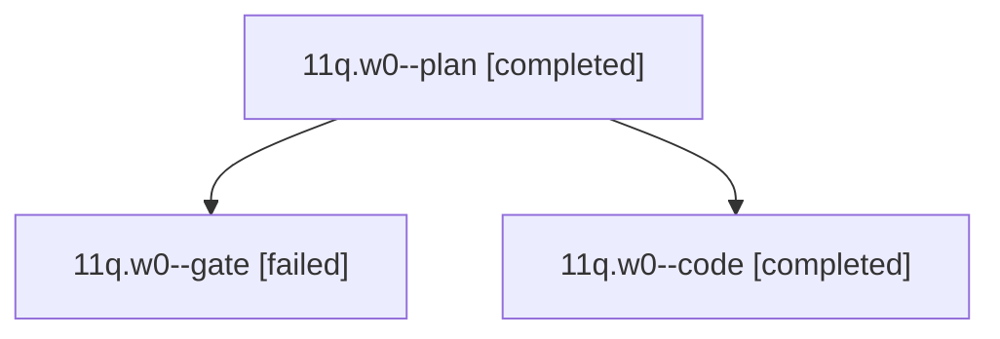

# Session: 11q.w0

[Agent Hoods](../README.md) / [bbugyi200](../users/bbugyi200/README.md) / [athena](../users/bbugyi200/machines/athena/README.md) / [11q](../users/bbugyi200/machines/athena/hoods/11q/README.md) / 11q.w0

Owner: `bbugyi200.athena` · Hood: `11q` · Members: 3

## Lineage

The diagram is an optional enhancement; the ordered table below contains the same lineage in accessible text.

| Role | Agent | State | Model / provider | Timing | Commits | Prompt | Chat |
|---|---|---|---|---|---:|---|---|
| plan | 11q.w0--plan | completed | opus / claude | 2026-10-19T13:44:25.295047+00:00 → 2026-10-19T13:56:42.875011+00:00 | 0 | [Prompt](../agents/bbugyi200.athena.11q.w0--plan/prompt.md) | [Chat](../agents/bbugyi200.athena.11q.w0--plan/chat.md) |
| gate | 11q.w0--gate | failed | opus / claude | 2026-10-19T13:56:56.212701+00:00 → 2026-10-19T13:57:37.406964+00:00 | 0 | — | [Chat](../agents/bbugyi200.athena.11q.w0--gate/chat.md) |
| code | 11q.w0--code | completed | grok-4.6 / grok | 2026-10-19T13:58:15.167734+00:00 → 2026-10-19T14:25:31.662272+00:00 | 0 | [Prompt](../agents/bbugyi200.athena.11q.w0--code/prompt.md) | — |

## Neighbors

| Agent | Relation | State |
|---|---|---|
| [11q](bbugyi200.athena.11q.md) (session · 8) | ancestor | completed 4, failed 4 |
