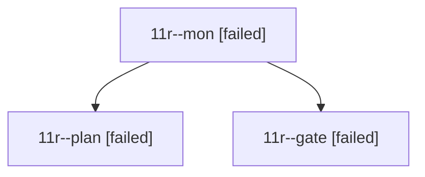

# Session: 11r

[Agent Hoods](../README.md) / [bbugyi200](../users/bbugyi200/README.md) / [athena](../users/bbugyi200/machines/athena/README.md) / [11r](../users/bbugyi200/machines/athena/hoods/11r/README.md) / 11r

Owner: `bbugyi200.athena` · Hood: `11r` · Members: 3

## Lineage

The diagram is an optional enhancement; the ordered table below contains the same lineage in accessible text.

| Role | Agent | State | Model / provider | Timing | Commits | Prompt | Chat |
|---|---|---|---|---|---:|---|---|
| mon | 11r--mon | failed | opus / claude | 2026-10-19T13:47:13.470426+00:00 → 2026-10-19T13:50:00.396656+00:00 | 0 | — | [Chat](../agents/bbugyi200.athena.11r--mon/chat.md) |
| plan | 11r--plan | failed | opus / claude | 2026-10-19T13:31:26.987469+00:00 → 2026-10-19T13:47:23.105096+00:00 | 0 | [Prompt](../agents/bbugyi200.athena.11r--plan/prompt.md) | [Chat](../agents/bbugyi200.athena.11r--plan/chat.md) |
| gate | 11r--gate | failed | opus / claude | 2026-10-19T13:46:46.286741+00:00 → 2026-10-19T13:47:14.052942+00:00 | 0 | — | [Chat](../agents/bbugyi200.athena.11r--gate/chat.md) |
