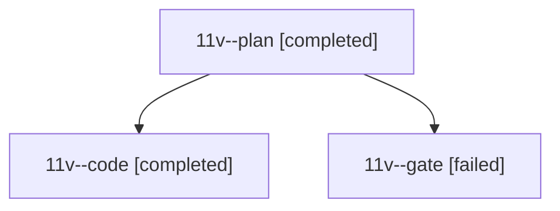

# Session: 11v

[Agent Hoods](../README.md) / [bbugyi200](../users/bbugyi200/README.md) / [athena](../users/bbugyi200/machines/athena/README.md) / [11v](../users/bbugyi200/machines/athena/hoods/11v/README.md) / 11v

Owner: `bbugyi200.athena` · Hood: `11v` · Members: 3

## Lineage

The diagram is an optional enhancement; the ordered table below contains the same lineage in accessible text.

| Role | Agent | State | Model / provider | Timing | Commits | Prompt | Chat |
|---|---|---|---|---|---:|---|---|
| plan | 11v--plan | completed | opus / claude | 2026-10-19T14:51:27.693038+00:00 → 2026-10-19T15:04:48.259410+00:00 | 0 | [Prompt](../agents/bbugyi200.athena.11v--plan/prompt.md) | [Chat](../agents/bbugyi200.athena.11v--plan/chat.md) |
| code | 11v--code | completed | grok-4.6 / grok | 2026-10-19T15:15:28.128336+00:00 → 2026-10-19T16:14:34.049720+00:00 | 0 | [Prompt](../agents/bbugyi200.athena.11v--code/prompt.md) | — |
| gate | 11v--gate | failed | opus / claude | 2026-10-19T15:12:41.357531+00:00 → 2026-10-19T15:14:07.680081+00:00 | 0 | — | [Chat](../agents/bbugyi200.athena.11v--gate/chat.md) |

## Neighbors

| Agent | Relation | State |
|---|---|---|
| [11v.w0](../agents/bbugyi200.athena.11v.w0/README.md) | descendant | waiting |
