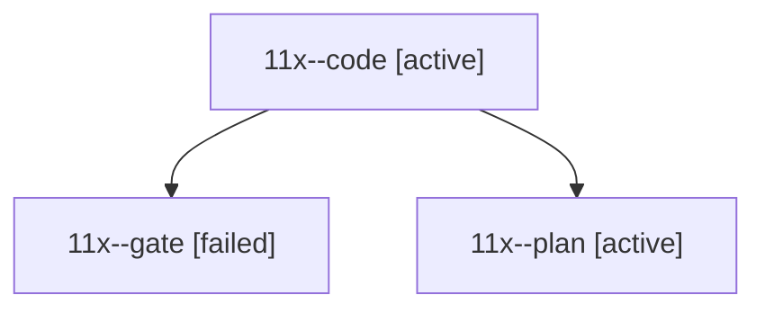

# Session: 11x

[Agent Hoods](../README.md) / [bbugyi200](../users/bbugyi200/README.md) / [athena](../users/bbugyi200/machines/athena/README.md) / [11x](../users/bbugyi200/machines/athena/hoods/11x/README.md) / 11x

Owner: `bbugyi200.athena` · Hood: `11x` · Members: 3

## Lineage

The diagram is an optional enhancement; the ordered table below contains the same lineage in accessible text.

| Role | Agent | State | Model / provider | Timing | Commits | Prompt | Chat |
|---|---|---|---|---|---:|---|---|
| code | 11x--code | active | grok-4.6 / grok | 2026-10-19T15:20:56.723780+00:00 | 0 | — | — |
| gate | 11x--gate | failed | opus / claude | 2026-10-19T15:18:53.148803+00:00 → 2026-10-19T15:19:58.591784+00:00 | 0 | — | [Chat](../agents/bbugyi200.athena.11x--gate/chat.md) |
| plan | 11x--plan | active | opus / claude | 2026-10-19T15:12:09.845412+00:00 | 0 | [Prompt](../agents/bbugyi200.athena.11x--plan/prompt.md) | [Chat](../agents/bbugyi200.athena.11x--plan/chat.md) |
