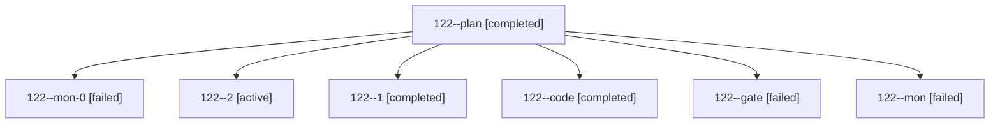

# Session: 122

[Agent Hoods](../README.md) / [bbugyi200](../users/bbugyi200/README.md) / [athena](../users/bbugyi200/machines/athena/README.md) / [122](../users/bbugyi200/machines/athena/hoods/122/README.md) / 122

Owner: `bbugyi200.athena` · Hood: `122` · Members: 7

## Lineage

The diagram is an optional enhancement; the ordered table below contains the same lineage in accessible text.

| Role | Agent | State | Model / provider | Timing | Commits | Prompt | Chat |
|---|---|---|---|---|---:|---|---|
| plan | 122--plan | completed | opus / claude | 2026-10-19T16:43:58.014778+00:00 → 2026-10-19T17:05:15.260530+00:00 | 0 | [Prompt](../agents/bbugyi200.athena.122--plan/prompt.md) | [Chat](../agents/bbugyi200.athena.122--plan/chat.md) |
| mon-0 | 122--mon-0 | failed | gpt-6-luna / codex | 2026-10-19T17:11:18.780108+00:00 → 2026-10-19T17:16:13.368962+00:00 | 0 | — | [Chat](../agents/bbugyi200.athena.122--mon-0/chat.md) |
| 2 | 122--2 | active | muse-spark-1.3-contributor / muse | 2026-10-19T17:16:53.061136+00:00 | [1](../agents/bbugyi200.athena.122--2/README.md#commits) | [Prompt](../agents/bbugyi200.athena.122--2/prompt.md) | — |
| 1 | 122--1 | completed | gpt-6-luna / codex | 2026-10-19T17:07:37.231901+00:00 → 2026-10-19T17:11:55.792512+00:00 | 0 | [Prompt](../agents/bbugyi200.athena.122--1/prompt.md) | [Chat](../agents/bbugyi200.athena.122--1/chat.md) |
| code | 122--code | completed | gpt-6-luna / codex | 2026-10-19T16:57:05.965258+00:00 → 2026-10-19T17:05:15.260530+00:00 | 0 | — | [Chat](../agents/bbugyi200.athena.122--code/chat.md) |
| gate | 122--gate | failed | opus / claude | 2026-10-19T16:56:10.648903+00:00 → 2026-10-19T16:56:39.504097+00:00 | 0 | — | [Chat](../agents/bbugyi200.athena.122--gate/chat.md) |
| mon | 122--mon | failed | gpt-6-luna / codex | 2026-10-19T17:04:41.797051+00:00 → 2026-10-19T17:06:50.510203+00:00 | 0 | — | [Chat](../agents/bbugyi200.athena.122--mon/chat.md) |

## Commits

| Role | Repo | Commit | Subject | Committed |
|---|---|---|---|---|
| 2 | bob-cli | [`67a26ea`](https://github.com/bobs-org/bob-cli/commit/67a26ea80a759b293188f17504a064385ee850c3) | fix(vault-sync): stop conflict loops from lock-interrupted fast-forwards and ignored conflict copies | 2026-10-19 13:33:19 EDT |
