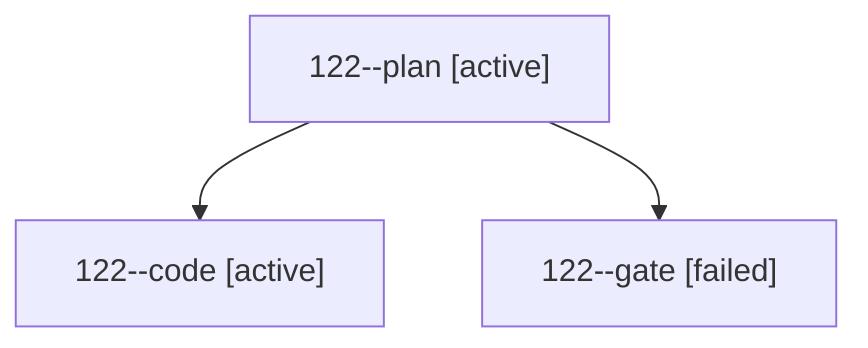

# Session: 122

[Agent Hoods](../README.md) / [bbugyi200](../users/bbugyi200/README.md) / [athena](../users/bbugyi200/machines/athena/README.md) / [122](../users/bbugyi200/machines/athena/hoods/122/README.md) / 122

Owner: `bbugyi200.athena` · Hood: `122` · Members: 3

## Lineage

The diagram is an optional enhancement; the ordered table below contains the same lineage in accessible text.

| Role | Agent | State | Model / provider | Timing | Commits | Prompt | Chat |
|---|---|---|---|---|---:|---|---|
| plan | 122--plan | active | opus / claude | 2026-10-19T16:43:58.014778+00:00 | 0 | [Prompt](../agents/bbugyi200.athena.122--plan/prompt.md) | [Chat](../agents/bbugyi200.athena.122--plan/chat.md) |
| code | 122--code | active | gpt-6-luna / codex | 2026-10-19T16:57:05.965258+00:00 | 0 | — | — |
| gate | 122--gate | failed | opus / claude | 2026-10-19T16:56:10.648903+00:00 → 2026-10-19T16:56:39.504097+00:00 | 0 | — | [Chat](../agents/bbugyi200.athena.122--gate/chat.md) |
