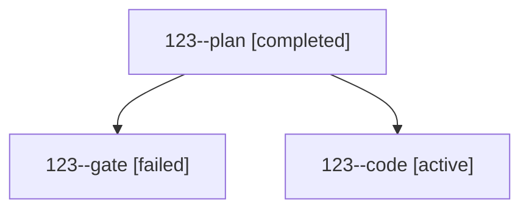

# Session: 123

[Agent Hoods](../README.md) / [bbugyi200](../users/bbugyi200/README.md) / [athena](../users/bbugyi200/machines/athena/README.md) / [123](../users/bbugyi200/machines/athena/hoods/123/README.md) / 123

Owner: `bbugyi200.athena` · Hood: `123` · Members: 3

## Lineage

The diagram is an optional enhancement; the ordered table below contains the same lineage in accessible text.

| Role | Agent | State | Model / provider | Timing | Commits | Prompt | Chat |
|---|---|---|---|---|---:|---|---|
| plan | 123--plan | completed | opus / claude | 2026-10-19T19:38:18.036554+00:00 → 2026-10-19T19:47:51.005196+00:00 | 0 | [Prompt](../agents/bbugyi200.athena.123--plan/prompt.md) | [Chat](../agents/bbugyi200.athena.123--plan/chat.md) |
| gate | 123--gate | failed | opus / claude | 2026-10-19T19:48:43.659410+00:00 → 2026-10-19T19:49:24.907304+00:00 | 0 | — | [Chat](../agents/bbugyi200.athena.123--gate/chat.md) |
| code | 123--code | active | muse-spark-1.3-contributor / muse | 2026-10-19T19:50:02.511553+00:00 | [1](../agents/bbugyi200.athena.123--code/README.md#commits) | [Prompt](../agents/bbugyi200.athena.123--code/prompt.md) | — |

## Commits

| Role | Repo | Commit | Subject | Committed |
|---|---|---|---|---|
| code | bob-cli | [`7d99ac0`](https://github.com/bobs-org/bob-cli/commit/7d99ac06e14236f5dc8dab50cf3b8d9ae1fc368a) | docs(vault-sync): drain ref intake every two minutes and note Refs pull lane | 2026-10-19 16:06:01 EDT |
