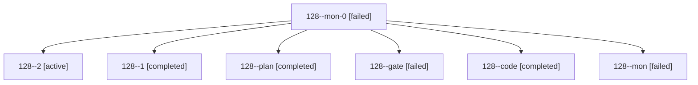

# Session: 128

[Agent Hoods](../README.md) / [bbugyi200](../users/bbugyi200/README.md) / [athena](../users/bbugyi200/machines/athena/README.md) / [128](../users/bbugyi200/machines/athena/hoods/128/README.md) / 128

Owner: `bbugyi200.athena` · Hood: `128` · Members: 7

## Lineage

The diagram is an optional enhancement; the ordered table below contains the same lineage in accessible text.

| Role | Agent | State | Model / provider | Timing | Commits | Prompt | Chat |
|---|---|---|---|---|---:|---|---|
| mon-0 | 128--mon-0 | failed | muse-spark-1.3-contributor / muse | 2026-10-19T21:32:00.262561+00:00 → 2026-10-19T21:45:41.322763+00:00 | 0 | — | [Chat](../agents/bbugyi200.athena.128--mon-0/chat.md) |
| 2 | 128--2 | active | muse-spark-1.3-contributor / muse | 2026-10-19T21:46:54.059204+00:00 | 0 | [Prompt](../agents/bbugyi200.athena.128--2/prompt.md) | — |
| 1 | 128--1 | completed | muse-spark-1.3-contributor / muse | 2026-10-19T21:27:22.153891+00:00 → 2026-10-19T21:33:04.488430+00:00 | 0 | [Prompt](../agents/bbugyi200.athena.128--1/prompt.md) | [Chat](../agents/bbugyi200.athena.128--1/chat.md) |
| plan | 128--plan | completed | opus / claude | 2026-10-19T20:45:32.777753+00:00 → 2026-10-19T21:13:30.031257+00:00 | 0 | [Prompt](../agents/bbugyi200.athena.128--plan/prompt.md) | [Chat](../agents/bbugyi200.athena.128--plan/chat.md) |
| gate | 128--gate | failed | opus / claude | 2026-10-19T21:00:53.938930+00:00 → 2026-10-19T21:01:23.801625+00:00 | 0 | — | [Chat](../agents/bbugyi200.athena.128--gate/chat.md) |
| code | 128--code | completed | muse-spark-1.3-contributor / muse | 2026-10-19T21:01:47.119823+00:00 → 2026-10-19T21:13:30.031257+00:00 | 0 | — | [Chat](../agents/bbugyi200.athena.128--code/chat.md) |
| mon | 128--mon | failed | muse-spark-1.3-contributor / muse | 2026-10-19T21:12:25.651540+00:00 → 2026-10-19T21:25:44.646054+00:00 | 0 | — | [Chat](../agents/bbugyi200.athena.128--mon/chat.md) |
