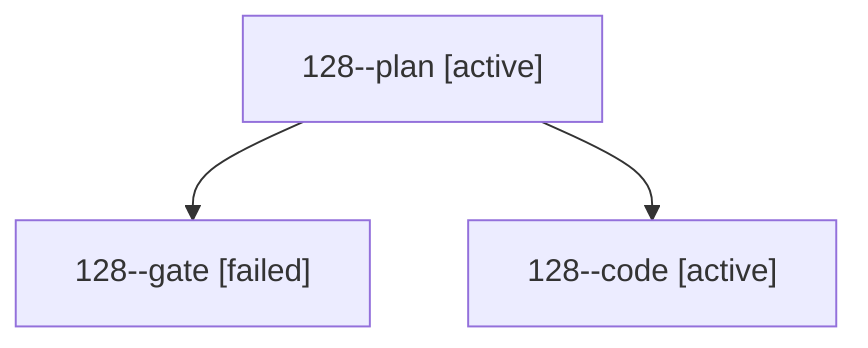

# Session: 128

[Agent Hoods](../README.md) / [bbugyi200](../users/bbugyi200/README.md) / [athena](../users/bbugyi200/machines/athena/README.md) / [128](../users/bbugyi200/machines/athena/hoods/128/README.md) / 128

Owner: `bbugyi200.athena` · Hood: `128` · Members: 3

## Lineage

The diagram is an optional enhancement; the ordered table below contains the same lineage in accessible text.

| Role | Agent | State | Model / provider | Timing | Commits | Prompt | Chat |
|---|---|---|---|---|---:|---|---|
| plan | 128--plan | active | opus / claude | 2026-10-19T20:45:32.777753+00:00 | 0 | [Prompt](../agents/bbugyi200.athena.128--plan/prompt.md) | [Chat](../agents/bbugyi200.athena.128--plan/chat.md) |
| gate | 128--gate | failed | opus / claude | 2026-10-19T21:00:53.938930+00:00 → 2026-10-19T21:01:23.801625+00:00 | 0 | — | [Chat](../agents/bbugyi200.athena.128--gate/chat.md) |
| code | 128--code | active | muse-spark-1.3-contributor / muse | 2026-10-19T21:01:47.119823+00:00 | 0 | — | — |
