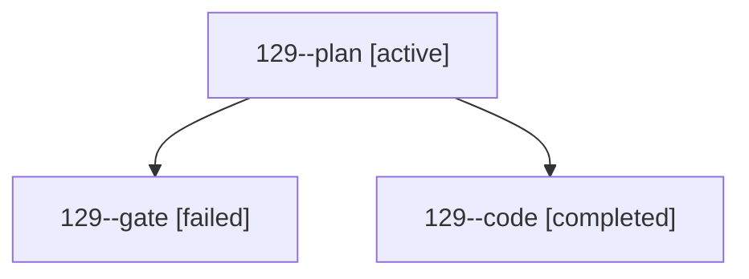

# Session: 129

[Agent Hoods](../README.md) / [bbugyi200](../users/bbugyi200/README.md) / [athena](../users/bbugyi200/machines/athena/README.md) / [129](../users/bbugyi200/machines/athena/hoods/129/README.md) / 129

Owner: `bbugyi200.athena` · Hood: `129` · Members: 3

## Lineage

The diagram is an optional enhancement; the ordered table below contains the same lineage in accessible text.

| Role | Agent | State | Model / provider | Timing | Commits | Prompt | Chat |
|---|---|---|---|---|---:|---|---|
| plan | 129--plan | active | opus / claude | 2026-10-19T22:37:48.612835+00:00 | 0 | [Prompt](../agents/bbugyi200.athena.129--plan/prompt.md) | [Chat](../agents/bbugyi200.athena.129--plan/chat.md) |
| gate | 129--gate | failed | opus / claude | 2026-10-19T22:46:47.688009+00:00 → 2026-10-19T22:47:16.049304+00:00 | 0 | — | [Chat](../agents/bbugyi200.athena.129--gate/chat.md) |
| code | 129--code | completed | muse-spark-1.3-contributor / muse | 2026-10-19T22:47:56.065103+00:00 → 2026-10-19T23:03:56.046268+00:00 | 0 | — | — |
