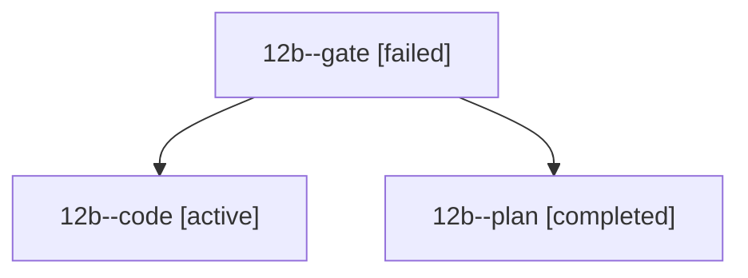

# Session: 12b

[Agent Hoods](../README.md) / [bbugyi200](../users/bbugyi200/README.md) / [athena](../users/bbugyi200/machines/athena/README.md) / [12b](../users/bbugyi200/machines/athena/hoods/12b/README.md) / 12b

Owner: `bbugyi200.athena` · Hood: `12b` · Members: 3

## Lineage

The diagram is an optional enhancement; the ordered table below contains the same lineage in accessible text.

| Role | Agent | State | Model / provider | Timing | Commits | Prompt | Chat |
|---|---|---|---|---|---:|---|---|
| gate | 12b--gate | failed | opus / claude | 2026-10-20T10:51:39.818658+00:00 → 2026-10-20T10:53:43.672843+00:00 | 0 | — | [Chat](../agents/bbugyi200.athena.12b--gate/chat.md) |
| code | 12b--code | active | grok-4.6 / grok | 2026-10-20T10:54:36.521004+00:00 | 0 | [Prompt](../agents/bbugyi200.athena.12b--code/prompt.md) | — |
| plan | 12b--plan | completed | opus / claude | 2026-10-20T10:38:03.448668+00:00 → 2026-10-20T10:49:25.465508+00:00 | 0 | [Prompt](../agents/bbugyi200.athena.12b--plan/prompt.md) | [Chat](../agents/bbugyi200.athena.12b--plan/chat.md) |
