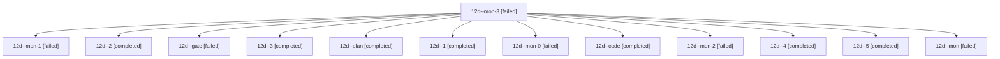

# Session: 12d

[Agent Hoods](../README.md) / [bbugyi200](../users/bbugyi200/README.md) / [athena](../users/bbugyi200/machines/athena/README.md) / [12d](../users/bbugyi200/machines/athena/hoods/12d/README.md) / 12d

Owner: `bbugyi200.athena` · Hood: `12d` · Members: 13

## Lineage

The diagram is an optional enhancement; the ordered table below contains the same lineage in accessible text.

| Role | Agent | State | Model / provider | Timing | Commits | Prompt | Chat |
|---|---|---|---|---|---:|---|---|
| mon-3 | 12d--mon-3 | failed | gpt-6-luna / codex | 2026-10-20T13:09:32.881617+00:00 → 2026-10-20T13:11:46.212774+00:00 | 0 | — | [Chat](../agents/bbugyi200.athena.12d--mon-3/chat.md) |
| mon-1 | 12d--mon-1 | failed | gpt-6-luna / codex | 2026-10-20T12:36:41.445467+00:00 → 2026-10-20T12:46:57.542120+00:00 | 0 | — | [Chat](../agents/bbugyi200.athena.12d--mon-1/chat.md) |
| 2 | 12d--2 | completed | gpt-6-luna / codex | 2026-10-20T12:21:48.153944+00:00 → 2026-10-20T12:40:13.071076+00:00 | 0 | [Prompt](../agents/bbugyi200.athena.12d--2/prompt.md) | [Chat](../agents/bbugyi200.athena.12d--2/chat.md) |
| gate | 12d--gate | failed | opus / claude | 2026-10-20T11:15:47.735954+00:00 → 2026-10-20T11:19:06.963146+00:00 | 0 | — | [Chat](../agents/bbugyi200.athena.12d--gate/chat.md) |
| 3 | 12d--3 | completed | gpt-6-luna / codex | 2026-10-20T12:48:33.287314+00:00 → 2026-10-20T12:56:20.611913+00:00 | 0 | [Prompt](../agents/bbugyi200.athena.12d--3/prompt.md) | [Chat](../agents/bbugyi200.athena.12d--3/chat.md) |
| plan | 12d--plan | completed | opus / claude | 2026-10-20T11:06:37.772541+00:00 → 2026-10-20T11:16:39.597428+00:00 | 0 | [Prompt](../agents/bbugyi200.athena.12d--plan/prompt.md) | [Chat](../agents/bbugyi200.athena.12d--plan/chat.md) |
| 1 | 12d--1 | completed | gpt-6-luna / codex | 2026-10-20T12:04:45.739139+00:00 → 2026-10-20T12:14:24.707089+00:00 | 0 | [Prompt](../agents/bbugyi200.athena.12d--1/prompt.md) | [Chat](../agents/bbugyi200.athena.12d--1/chat.md) |
| mon-0 | 12d--mon-0 | failed | gpt-6-luna / codex | 2026-10-20T12:13:30.314148+00:00 → 2026-10-20T12:15:38.541640+00:00 | 0 | — | [Chat](../agents/bbugyi200.athena.12d--mon-0/chat.md) |
| code | 12d--code | completed | gpt-6-luna / codex | 2026-10-20T11:36:14.786424+00:00 → 2026-10-20T11:56:18.116028+00:00 | 0 | [Prompt](../agents/bbugyi200.athena.12d--code/prompt.md) | [Chat](../agents/bbugyi200.athena.12d--code/chat.md) |
| mon-2 | 12d--mon-2 | failed | gpt-6-luna / codex | 2026-10-20T12:55:45.383049+00:00 → 2026-10-20T13:00:38.297999+00:00 | 0 | — | [Chat](../agents/bbugyi200.athena.12d--mon-2/chat.md) |
| 4 | 12d--4 | completed | gpt-6-luna / codex | 2026-10-20T13:01:57.428132+00:00 → 2026-10-20T13:10:38.119207+00:00 | 0 | [Prompt](../agents/bbugyi200.athena.12d--4/prompt.md) | [Chat](../agents/bbugyi200.athena.12d--4/chat.md) |
| 5 | 12d--5 | completed | gpt-6-luna / codex | 2026-10-20T13:12:50.952992+00:00 → 2026-10-20T13:20:52.313341+00:00 | [1](../agents/bbugyi200.athena.12d--5/README.md#commits) | [Prompt](../agents/bbugyi200.athena.12d--5/prompt.md) | — |
| mon | 12d--mon | failed | gpt-6-luna / codex | 2026-10-20T11:55:32.537001+00:00 → 2026-10-20T12:03:57.295164+00:00 | 0 | — | [Chat](../agents/bbugyi200.athena.12d--mon/chat.md) |

## Commits

| Role | Repo | Commit | Subject | Committed |
|---|---|---|---|---|
| 5 | — | `0e9f915` | feat(capture): support triple-at template start | 2026-10-20 09:18:04 EDT |
