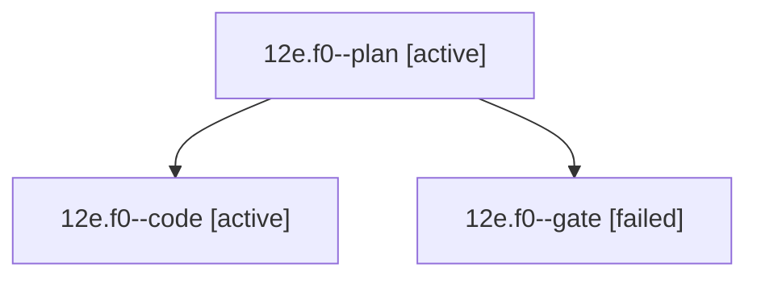

# Session: 12e.f0

[Agent Hoods](../README.md) / [bbugyi200](../users/bbugyi200/README.md) / [athena](../users/bbugyi200/machines/athena/README.md) / [12e](../users/bbugyi200/machines/athena/hoods/12e/README.md) / 12e.f0

Owner: `bbugyi200.athena` · Hood: `12e` · Members: 3

## Lineage

The diagram is an optional enhancement; the ordered table below contains the same lineage in accessible text.

| Role | Agent | State | Model / provider | Timing | Commits | Prompt | Chat |
|---|---|---|---|---|---:|---|---|
| plan | 12e.f0--plan | active | opus / claude | 2026-10-20T13:39:53.750602+00:00 | 0 | [Prompt](../agents/bbugyi200.athena.12e.f0--plan/prompt.md) | [Chat](../agents/bbugyi200.athena.12e.f0--plan/chat.md) |
| code | 12e.f0--code | active | grok-4.6 / grok | 2026-10-20T13:44:33.845957+00:00 | 0 | — | — |
| gate | 12e.f0--gate | failed | opus / claude | 2026-10-20T13:43:37.044880+00:00 → 2026-10-20T13:44:08.340388+00:00 | 0 | — | [Chat](../agents/bbugyi200.athena.12e.f0--gate/chat.md) |

## Neighbors

| Agent | Relation | State |
|---|---|---|
| [12e](bbugyi200.athena.12e.md) (session · 5) | ancestor | completed 3, failed 2 |
| [12e.f0.w0](../agents/bbugyi200.athena.12e.f0.w0/README.md) | descendant | waiting |
