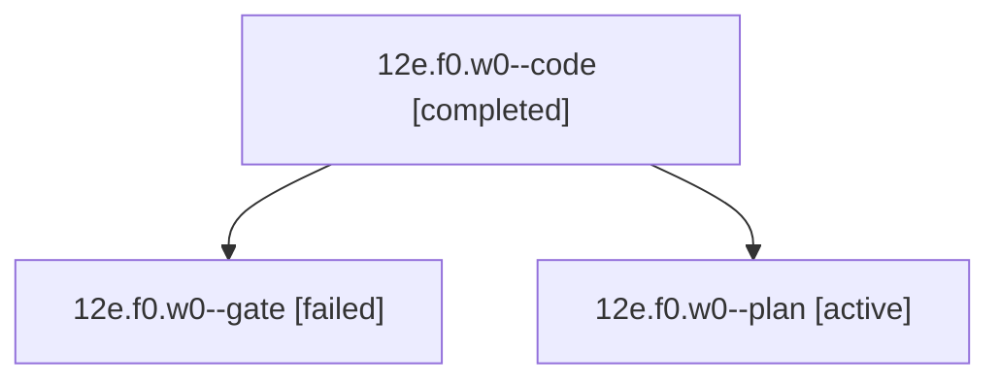

# Session: 12e.f0.w0

[Agent Hoods](../README.md) / [bbugyi200](../users/bbugyi200/README.md) / [athena](../users/bbugyi200/machines/athena/README.md) / [12e](../users/bbugyi200/machines/athena/hoods/12e/README.md) / 12e.f0.w0

Owner: `bbugyi200.athena` · Hood: `12e` · Members: 3

## Lineage

The diagram is an optional enhancement; the ordered table below contains the same lineage in accessible text.

| Role | Agent | State | Model / provider | Timing | Commits | Prompt | Chat |
|---|---|---|---|---|---:|---|---|
| code | 12e.f0.w0--code | completed | gpt-6-luna / codex | 2026-10-20T14:06:18.436575+00:00 → 2026-10-20T14:19:49.312291+00:00 | 0 | — | — |
| gate | 12e.f0.w0--gate | failed | opus / claude | 2026-10-20T14:05:03.477975+00:00 → 2026-10-20T14:05:51.341687+00:00 | 0 | — | [Chat](../agents/bbugyi200.athena.12e.f0.w0--gate/chat.md) |
| plan | 12e.f0.w0--plan | active | opus / claude | 2026-10-20T13:58:01.109117+00:00 | 0 | [Prompt](../agents/bbugyi200.athena.12e.f0.w0--plan/prompt.md) | [Chat](../agents/bbugyi200.athena.12e.f0.w0--plan/chat.md) |

## Neighbors

| Agent | Relation | State |
|---|---|---|
| [12e.f0](bbugyi200.athena.12e.f0.md) (session · 3) | ancestor | completed 2, failed 1 |
| [12e](bbugyi200.athena.12e.md) (session · 5) | ancestor | completed 3, failed 2 |
