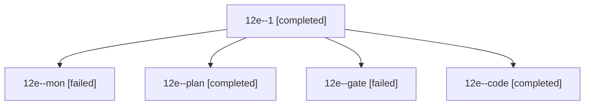

# Session: 12e

[Agent Hoods](../README.md) / [bbugyi200](../users/bbugyi200/README.md) / [athena](../users/bbugyi200/machines/athena/README.md) / [12e](../users/bbugyi200/machines/athena/hoods/12e/README.md) / 12e

Owner: `bbugyi200.athena` · Hood: `12e` · Members: 5

## Lineage

The diagram is an optional enhancement; the ordered table below contains the same lineage in accessible text.

| Role | Agent | State | Model / provider | Timing | Commits | Prompt | Chat |
|---|---|---|---|---|---:|---|---|
| 1 | 12e--1 | completed | gpt-6-luna / codex | 2026-10-20T12:46:44.423728+00:00 → 2026-10-20T12:55:24.540931+00:00 | 0 | [Prompt](../agents/bbugyi200.athena.12e--1/prompt.md) | [Chat](../agents/bbugyi200.athena.12e--1/chat.md) |
| mon | 12e--mon | failed | gpt-6-luna / codex | 2026-10-20T12:39:01.224721+00:00 → 2026-10-20T12:45:14.804536+00:00 | 0 | — | [Chat](../agents/bbugyi200.athena.12e--mon/chat.md) |
| plan | 12e--plan | completed | opus / claude | 2026-10-20T11:48:29.411528+00:00 → 2026-10-20T12:04:02.519060+00:00 | 0 | [Prompt](../agents/bbugyi200.athena.12e--plan/prompt.md) | [Chat](../agents/bbugyi200.athena.12e--plan/chat.md) |
| gate | 12e--gate | failed | opus / claude | 2026-10-20T12:14:28.311804+00:00 → 2026-10-20T12:15:17.213192+00:00 | 0 | — | [Chat](../agents/bbugyi200.athena.12e--gate/chat.md) |
| code | 12e--code | completed | gpt-6-luna / codex | 2026-10-20T12:16:10.965535+00:00 → 2026-10-20T12:40:16.280316+00:00 | 0 | [Prompt](../agents/bbugyi200.athena.12e--code/prompt.md) | [Chat](../agents/bbugyi200.athena.12e--code/chat.md) |

## Neighbors

| Agent | Relation | State |
|---|---|---|
| [12e.f0](bbugyi200.athena.12e.f0.md) (session · 3) | descendant | completed 2, failed 1 |
| [12e.f0.w0](bbugyi200.athena.12e.f0.w0.md) (session · 3) | descendant | active 2, failed 1 |
