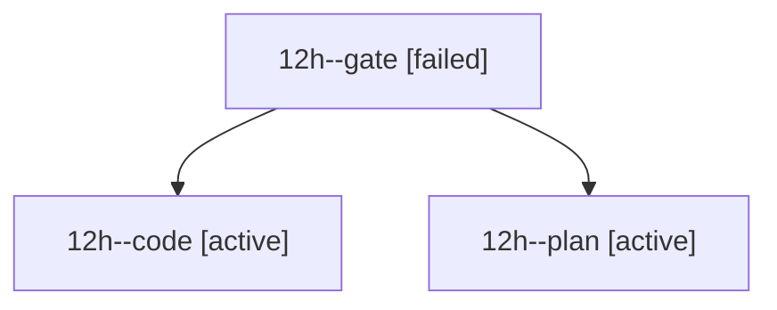

# Session: 12h

[Agent Hoods](../README.md) / [bbugyi200](../users/bbugyi200/README.md) / [athena](../users/bbugyi200/machines/athena/README.md) / [12h](../users/bbugyi200/machines/athena/hoods/12h/README.md) / 12h

Owner: `bbugyi200.athena` · Hood: `12h` · Members: 3

## Lineage

The diagram is an optional enhancement; the ordered table below contains the same lineage in accessible text.

| Role | Agent | State | Model / provider | Timing | Commits | Prompt | Chat |
|---|---|---|---|---|---:|---|---|
| gate | 12h--gate | failed | opus / claude | 2026-10-20T17:09:30.251983+00:00 → 2026-10-20T17:09:58.695112+00:00 | 0 | — | [Chat](../agents/bbugyi200.athena.12h--gate/chat.md) |
| code | 12h--code | active | muse-spark-1.3-contributor / muse | 2026-10-20T17:10:27.698802+00:00 | 0 | — | — |
| plan | 12h--plan | active | opus / claude | 2026-10-20T16:53:11.206628+00:00 | 0 | [Prompt](../agents/bbugyi200.athena.12h--plan/prompt.md) | [Chat](../agents/bbugyi200.athena.12h--plan/chat.md) |
