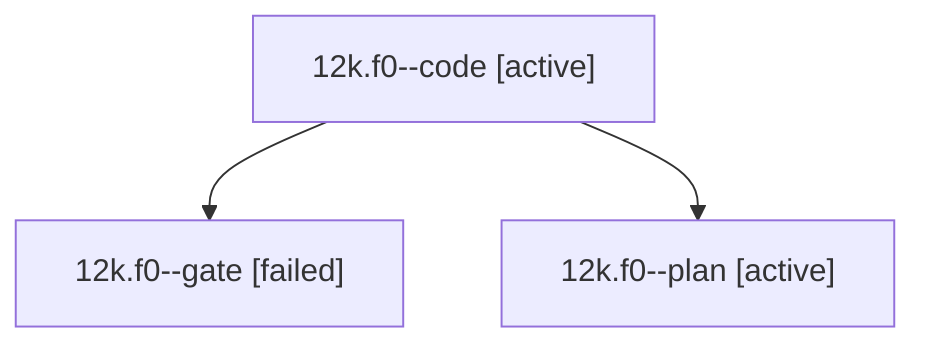

# Session: 12k.f0

[Agent Hoods](../README.md) / [bbugyi200](../users/bbugyi200/README.md) / [athena](../users/bbugyi200/machines/athena/README.md) / [12k](../users/bbugyi200/machines/athena/hoods/12k/README.md) / 12k.f0

Owner: `bbugyi200.athena` · Hood: `12k` · Members: 3

## Lineage

The diagram is an optional enhancement; the ordered table below contains the same lineage in accessible text.

| Role | Agent | State | Model / provider | Timing | Commits | Prompt | Chat |
|---|---|---|---|---|---:|---|---|
| code | 12k.f0--code | active | grok-4.6 / grok | 2026-10-20T18:17:42.016439+00:00 | 0 | — | — |
| gate | 12k.f0--gate | failed | opus / claude | 2026-10-20T18:16:47.035089+00:00 → 2026-10-20T18:17:16.520077+00:00 | 0 | — | [Chat](../agents/bbugyi200.athena.12k.f0--gate/chat.md) |
| plan | 12k.f0--plan | active | opus / claude | 2026-10-20T18:04:24.522715+00:00 | 0 | [Prompt](../agents/bbugyi200.athena.12k.f0--plan/prompt.md) | [Chat](../agents/bbugyi200.athena.12k.f0--plan/chat.md) |

## Neighbors

| Agent | Relation | State |
|---|---|---|
| [12k](bbugyi200.athena.12k.md) (session · 5) | ancestor | completed 3, failed 2 |
