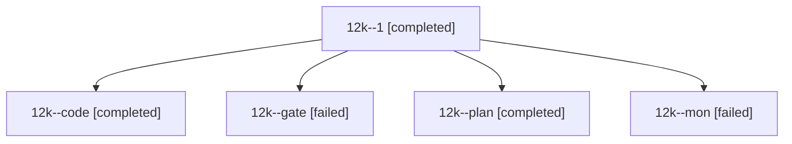

# Session: 12k

[Agent Hoods](../README.md) / [bbugyi200](../users/bbugyi200/README.md) / [athena](../users/bbugyi200/machines/athena/README.md) / [12k](../users/bbugyi200/machines/athena/hoods/12k/README.md) / 12k

Owner: `bbugyi200.athena` · Hood: `12k` · Members: 5

## Lineage

The diagram is an optional enhancement; the ordered table below contains the same lineage in accessible text.

| Role | Agent | State | Model / provider | Timing | Commits | Prompt | Chat |
|---|---|---|---|---|---:|---|---|
| 1 | 12k--1 | completed | gpt-6-luna / codex | 2026-10-20T18:06:20.170388+00:00 → 2026-10-20T18:11:47.215628+00:00 | 0 | [Prompt](../agents/bbugyi200.athena.12k--1/prompt.md) | [Chat](../agents/bbugyi200.athena.12k--1/chat.md) |
| code | 12k--code | completed | gpt-6-luna / codex | 2026-10-20T17:42:24.040766+00:00 → 2026-10-20T17:56:56.449699+00:00 | 0 | — | [Chat](../agents/bbugyi200.athena.12k--code/chat.md) |
| gate | 12k--gate | failed | opus / claude | 2026-10-20T17:40:41.183616+00:00 → 2026-10-20T17:41:55.585705+00:00 | 0 | — | [Chat](../agents/bbugyi200.athena.12k--gate/chat.md) |
| plan | 12k--plan | completed | opus / claude | 2026-10-20T17:34:59.483299+00:00 → 2026-10-20T17:56:56.449699+00:00 | 0 | [Prompt](../agents/bbugyi200.athena.12k--plan/prompt.md) | [Chat](../agents/bbugyi200.athena.12k--plan/chat.md) |
| mon | 12k--mon | failed | gpt-6-luna / codex | 2026-10-20T17:55:57.706078+00:00 → 2026-10-20T17:58:46.320606+00:00 | 0 | — | [Chat](../agents/bbugyi200.athena.12k--mon/chat.md) |

## Neighbors

| Agent | Relation | State |
|---|---|---|
| [12k.f0](bbugyi200.athena.12k.f0.md) (session · 3) | descendant | active 2, failed 1 |
