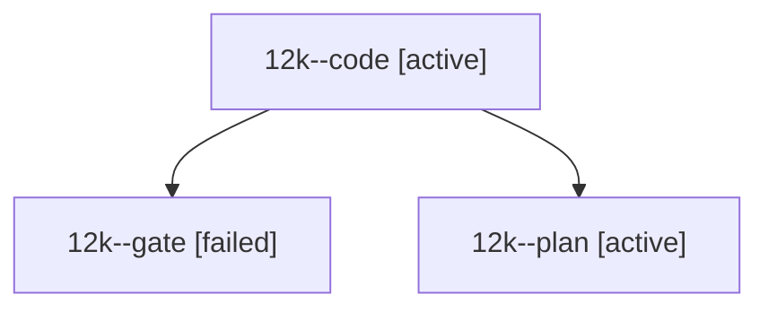

# Session: 12k

[Agent Hoods](../README.md) / [bbugyi200](../users/bbugyi200/README.md) / [athena](../users/bbugyi200/machines/athena/README.md) / [12k](../users/bbugyi200/machines/athena/hoods/12k/README.md) / 12k

Owner: `bbugyi200.athena` · Hood: `12k` · Members: 3

## Lineage

The diagram is an optional enhancement; the ordered table below contains the same lineage in accessible text.

| Role | Agent | State | Model / provider | Timing | Commits | Prompt | Chat |
|---|---|---|---|---|---:|---|---|
| code | 12k--code | active | gpt-6-luna / codex | 2026-10-20T17:42:24.040766+00:00 | 0 | — | — |
| gate | 12k--gate | failed | opus / claude | 2026-10-20T17:40:41.183616+00:00 → 2026-10-20T17:41:55.585705+00:00 | 0 | — | [Chat](../agents/bbugyi200.athena.12k--gate/chat.md) |
| plan | 12k--plan | active | opus / claude | 2026-10-20T17:34:59.483299+00:00 | 0 | [Prompt](../agents/bbugyi200.athena.12k--plan/prompt.md) | [Chat](../agents/bbugyi200.athena.12k--plan/chat.md) |

## Neighbors

| Agent | Relation | State |
|---|---|---|
| [12k.f0](../agents/bbugyi200.athena.12k.f0/README.md) | descendant | waiting |
