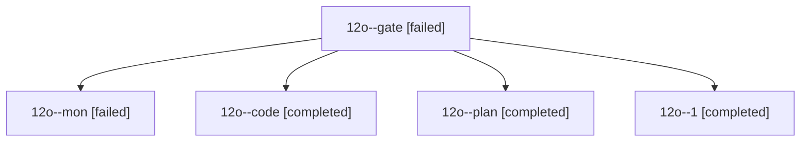

# Session: 12o

[Agent Hoods](../README.md) / [bbugyi200](../users/bbugyi200/README.md) / [athena](../users/bbugyi200/machines/athena/README.md) / [12o](../users/bbugyi200/machines/athena/hoods/12o/README.md) / 12o

Owner: `bbugyi200.athena` · Hood: `12o` · Members: 5

## Lineage

The diagram is an optional enhancement; the ordered table below contains the same lineage in accessible text.

| Role | Agent | State | Model / provider | Timing | Commits | Prompt | Chat |
|---|---|---|---|---|---:|---|---|
| gate | 12o--gate | failed | opus / claude | 2026-10-20T20:41:39.948224+00:00 → 2026-10-20T20:42:32.008621+00:00 | 0 | — | [Chat](../agents/bbugyi200.athena.12o--gate/chat.md) |
| mon | 12o--mon | failed | gpt-6-luna / codex | 2026-10-20T20:50:51.786071+00:00 → 2026-10-20T20:54:20.745521+00:00 | 0 | — | [Chat](../agents/bbugyi200.athena.12o--mon/chat.md) |
| code | 12o--code | completed | gpt-6-luna / codex | 2026-10-20T20:43:06.491772+00:00 → 2026-10-20T20:51:48.041372+00:00 | 0 | — | [Chat](../agents/bbugyi200.athena.12o--code/chat.md) |
| plan | 12o--plan | completed | opus / claude | 2026-10-20T20:33:27.272595+00:00 → 2026-10-20T20:51:48.041372+00:00 | 0 | [Prompt](../agents/bbugyi200.athena.12o--plan/prompt.md) | [Chat](../agents/bbugyi200.athena.12o--plan/chat.md) |
| 1 | 12o--1 | completed | gpt-6-luna / codex | 2026-10-20T20:55:18.555542+00:00 → 2026-10-20T21:00:30.101642+00:00 | 0 | [Prompt](../agents/bbugyi200.athena.12o--1/prompt.md) | — |
