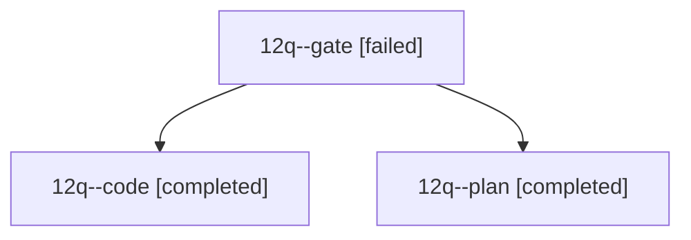

# Session: 12q

[Agent Hoods](../README.md) / [bbugyi200](../users/bbugyi200/README.md) / [athena](../users/bbugyi200/machines/athena/README.md) / [12q](../users/bbugyi200/machines/athena/hoods/12q/README.md) / 12q

Owner: `bbugyi200.athena` · Hood: `12q` · Members: 3

## Lineage

The diagram is an optional enhancement; the ordered table below contains the same lineage in accessible text.

| Role | Agent | State | Model / provider | Timing | Commits | Prompt | Chat |
|---|---|---|---|---|---:|---|---|
| gate | 12q--gate | failed | opus / claude | 2026-10-20T21:43:43.519669+00:00 → 2026-10-20T21:44:58.658744+00:00 | 0 | — | [Chat](../agents/bbugyi200.athena.12q--gate/chat.md) |
| code | 12q--code | completed | grok-4.6 / grok | 2026-10-20T21:46:01.986201+00:00 → 2026-10-20T22:40:32.321345+00:00 | [1](../agents/bbugyi200.athena.12q--code/README.md#commits) | [Prompt](../agents/bbugyi200.athena.12q--code/prompt.md) | — |
| plan | 12q--plan | completed | opus / claude | 2026-10-20T21:31:43.411882+00:00 → 2026-10-20T21:44:06.358251+00:00 | 0 | [Prompt](../agents/bbugyi200.athena.12q--plan/prompt.md) | [Chat](../agents/bbugyi200.athena.12q--plan/chat.md) |

## Commits

| Role | Repo | Commit | Subject | Committed |
|---|---|---|---|---|
| code | — | `68da53a` | feat(ref): render Highlights underlines as SGR 1;4 in bob ref show | 2026-10-20 18:38:20 EDT |
