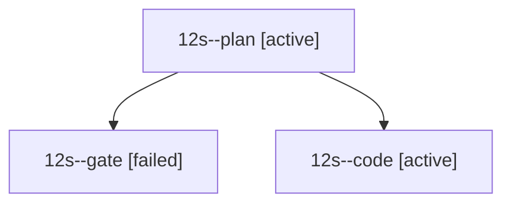

# Session: 12s

[Agent Hoods](../README.md) / [bbugyi200](../users/bbugyi200/README.md) / [athena](../users/bbugyi200/machines/athena/README.md) / [12s](../users/bbugyi200/machines/athena/hoods/12s/README.md) / 12s

Owner: `bbugyi200.athena` · Hood: `12s` · Members: 3

## Lineage

The diagram is an optional enhancement; the ordered table below contains the same lineage in accessible text.

| Role | Agent | State | Model / provider | Timing | Commits | Prompt | Chat |
|---|---|---|---|---|---:|---|---|
| plan | 12s--plan | active | opus / claude | 2026-10-21T11:42:51.536389+00:00 | 0 | [Prompt](../agents/bbugyi200.athena.12s--plan/prompt.md) | [Chat](../agents/bbugyi200.athena.12s--plan/chat.md) |
| gate | 12s--gate | failed | opus / claude | 2026-10-21T11:48:14.839661+00:00 → 2026-10-21T11:49:33.196332+00:00 | 0 | — | [Chat](../agents/bbugyi200.athena.12s--gate/chat.md) |
| code | 12s--code | active | grok-4.6 / grok | 2026-10-21T11:49:56.505445+00:00 | 0 | — | — |
