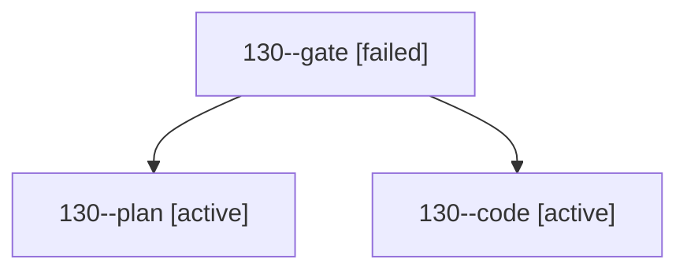

# Session: 130

[Agent Hoods](../README.md) / [bbugyi200](../users/bbugyi200/README.md) / [athena](../users/bbugyi200/machines/athena/README.md) / [130](../users/bbugyi200/machines/athena/hoods/130/README.md) / 130

Owner: `bbugyi200.athena` · Hood: `130` · Members: 3

## Lineage

The diagram is an optional enhancement; the ordered table below contains the same lineage in accessible text.

| Role | Agent | State | Model / provider | Timing | Commits | Prompt | Chat |
|---|---|---|---|---|---:|---|---|
| gate | 130--gate | failed | opus / claude | 2026-10-23T09:42:11.853914+00:00 → 2026-10-23T09:42:39.546343+00:00 | 0 | — | [Chat](../agents/bbugyi200.athena.130--gate/chat.md) |
| plan | 130--plan | active | opus / claude | 2026-10-23T09:38:34.398373+00:00 | 0 | [Prompt](../agents/bbugyi200.athena.130--plan/prompt.md) | [Chat](../agents/bbugyi200.athena.130--plan/chat.md) |
| code | 130--code | active | gpt-6-luna / codex | 2026-10-23T09:43:07.588769+00:00 | 0 | — | — |
