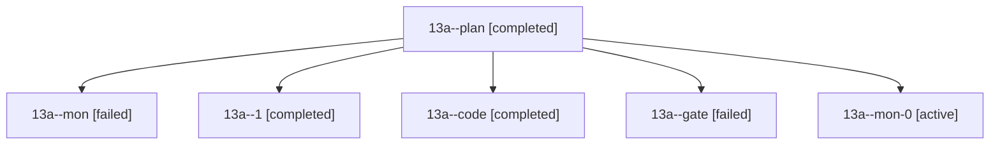

# Session: 13a

[Agent Hoods](../README.md) / [bbugyi200](../users/bbugyi200/README.md) / [athena](../users/bbugyi200/machines/athena/README.md) / [13a](../users/bbugyi200/machines/athena/hoods/13a/README.md) / 13a

Owner: `bbugyi200.athena` · Hood: `13a` · Members: 6

## Lineage

The diagram is an optional enhancement; the ordered table below contains the same lineage in accessible text.

| Role | Agent | State | Model / provider | Timing | Commits | Prompt | Chat |
|---|---|---|---|---|---:|---|---|
| plan | 13a--plan | completed | opus / claude | 2026-10-23T16:30:39.082662+00:00 → 2026-10-23T17:06:59.031779+00:00 | 0 | [Prompt](../agents/bbugyi200.athena.13a--plan/prompt.md) | [Chat](../agents/bbugyi200.athena.13a--plan/chat.md) |
| mon | 13a--mon | failed | gpt-6-luna / codex | 2026-10-23T17:04:33.819666+00:00 → 2026-10-23T17:09:08.849078+00:00 | 0 | — | [Chat](../agents/bbugyi200.athena.13a--mon/chat.md) |
| 1 | 13a--1 | completed | gpt-6-luna / codex | 2026-10-23T17:10:23.795686+00:00 → 2026-10-23T17:17:41.372538+00:00 | 0 | [Prompt](../agents/bbugyi200.athena.13a--1/prompt.md) | [Chat](../agents/bbugyi200.athena.13a--1/chat.md) |
| code | 13a--code | completed | gpt-6-luna / codex | 2026-10-23T16:57:07.709874+00:00 → 2026-10-23T17:06:59.031779+00:00 | 0 | — | [Chat](../agents/bbugyi200.athena.13a--code/chat.md) |
| gate | 13a--gate | failed | opus / claude | 2026-10-23T16:53:27.569615+00:00 → 2026-10-23T16:55:50.664622+00:00 | 0 | — | [Chat](../agents/bbugyi200.athena.13a--gate/chat.md) |
| mon-0 | 13a--mon-0 | active | gpt-6-luna / codex | 2026-10-23T17:16:30.715239+00:00 | 0 | — | — |
