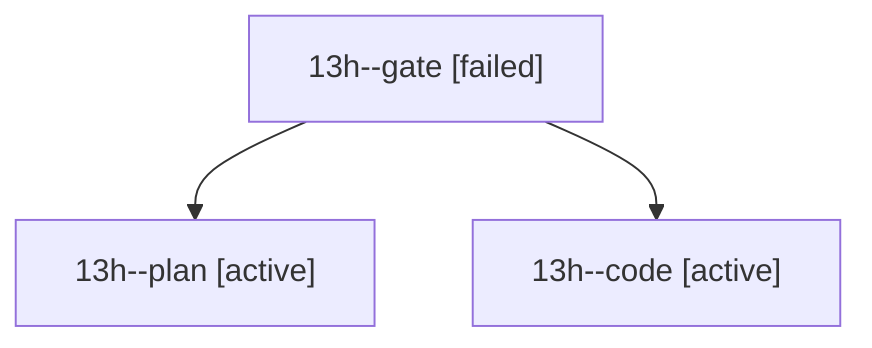

# Session: 13h

[Agent Hoods](../README.md) / [bbugyi200](../users/bbugyi200/README.md) / [athena](../users/bbugyi200/machines/athena/README.md) / [13h](../users/bbugyi200/machines/athena/hoods/13h/README.md) / 13h

Owner: `bbugyi200.athena` · Hood: `13h` · Members: 3

## Lineage

The diagram is an optional enhancement; the ordered table below contains the same lineage in accessible text.

| Role | Agent | State | Model / provider | Timing | Commits | Prompt | Chat |
|---|---|---|---|---|---:|---|---|
| gate | 13h--gate | failed | opus / claude | 2026-10-23T20:40:04.014424+00:00 → 2026-10-23T20:40:37.131799+00:00 | 0 | — | [Chat](../agents/bbugyi200.athena.13h--gate/chat.md) |
| plan | 13h--plan | active | opus / claude | 2026-10-23T20:30:55.297360+00:00 | 0 | [Prompt](../agents/bbugyi200.athena.13h--plan/prompt.md) | [Chat](../agents/bbugyi200.athena.13h--plan/chat.md) |
| code | 13h--code | active | grok-4.6 / grok | 2026-10-23T20:41:31.023763+00:00 | 0 | — | — |
