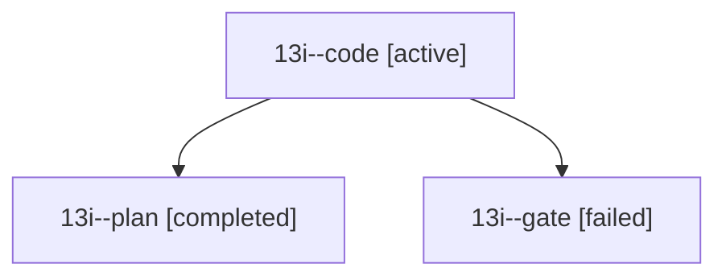

# Session: 13i

[Agent Hoods](../README.md) / [bbugyi200](../users/bbugyi200/README.md) / [athena](../users/bbugyi200/machines/athena/README.md) / [13i](../users/bbugyi200/machines/athena/hoods/13i/README.md) / 13i

Owner: `bbugyi200.athena` · Hood: `13i` · Members: 3

## Lineage

The diagram is an optional enhancement; the ordered table below contains the same lineage in accessible text.

| Role | Agent | State | Model / provider | Timing | Commits | Prompt | Chat |
|---|---|---|---|---|---:|---|---|
| code | 13i--code | active | grok-4.6 / grok | 2026-10-23T22:13:04.688472+00:00 | [1](../agents/bbugyi200.athena.13i--code/README.md#commits) | [Prompt](../agents/bbugyi200.athena.13i--code/prompt.md) | — |
| plan | 13i--plan | completed | opus / claude | 2026-10-23T21:52:54.355415+00:00 → 2026-10-23T22:08:39.528376+00:00 | 0 | [Prompt](../agents/bbugyi200.athena.13i--plan/prompt.md) | [Chat](../agents/bbugyi200.athena.13i--plan/chat.md) |
| gate | 13i--gate | failed | opus / claude | 2026-10-23T22:10:03.946778+00:00 → 2026-10-23T22:11:37.663567+00:00 | 0 | — | [Chat](../agents/bbugyi200.athena.13i--gate/chat.md) |

## Commits

| Role | Repo | Commit | Subject | Committed |
|---|---|---|---|---|
| code | bob-cli | [`a08581d`](https://github.com/bobs-org/bob-cli/commit/a08581d803cd71f46d80320338550e53ee63e9e3) | feat(highlights): restore stale Highlights saves and report PDF write coordination | 2026-10-23 18:54:12 EDT |
