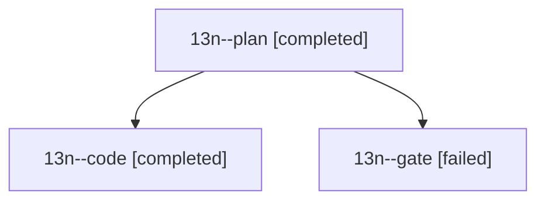

# Session: 13n

[Agent Hoods](../README.md) / [bbugyi200](../users/bbugyi200/README.md) / [athena](../users/bbugyi200/machines/athena/README.md) / [13n](../users/bbugyi200/machines/athena/hoods/13n/README.md) / 13n

Owner: `bbugyi200.athena` · Hood: `13n` · Members: 3

## Lineage

The diagram is an optional enhancement; the ordered table below contains the same lineage in accessible text.

| Role | Agent | State | Model / provider | Timing | Commits | Prompt | Chat |
|---|---|---|---|---|---:|---|---|
| plan | 13n--plan | completed | opus / claude | 2026-10-24T12:05:59.076511+00:00 → 2026-10-24T12:17:37.628450+00:00 | 0 | [Prompt](../agents/bbugyi200.athena.13n--plan/prompt.md) | [Chat](../agents/bbugyi200.athena.13n--plan/chat.md) |
| code | 13n--code | completed | grok-4.6 / grok | 2026-10-24T12:22:19.711311+00:00 → 2026-10-24T12:41:12.894227+00:00 | 0 | [Prompt](../agents/bbugyi200.athena.13n--code/prompt.md) | [Chat](../agents/bbugyi200.athena.13n--code/chat.md) |
| gate | 13n--gate | failed | opus / claude | 2026-10-24T12:17:03.898020+00:00 → 2026-10-24T12:20:44.192698+00:00 | 0 | — | [Chat](../agents/bbugyi200.athena.13n--gate/chat.md) |

## Neighbors

| Agent | Relation | State |
|---|---|---|
| [13n.w0](../agents/bbugyi200.athena.13n.w0/README.md) | descendant | active |
