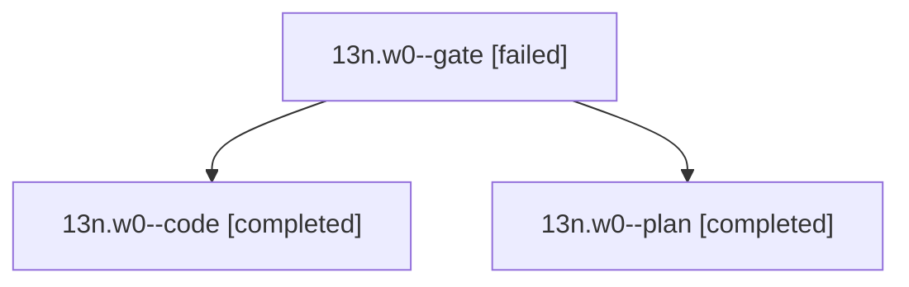

# Session: 13n.w0

[Agent Hoods](../README.md) / [bbugyi200](../users/bbugyi200/README.md) / [athena](../users/bbugyi200/machines/athena/README.md) / [13n](../users/bbugyi200/machines/athena/hoods/13n/README.md) / 13n.w0

Owner: `bbugyi200.athena` · Hood: `13n` · Members: 3

## Lineage

The diagram is an optional enhancement; the ordered table below contains the same lineage in accessible text.

| Role | Agent | State | Model / provider | Timing | Commits | Prompt | Chat |
|---|---|---|---|---|---:|---|---|
| gate | 13n.w0--gate | failed | opus / claude | 2026-10-24T12:55:59.517958+00:00 → 2026-10-24T12:56:56.010520+00:00 | 0 | — | [Chat](../agents/bbugyi200.athena.13n.w0--gate/chat.md) |
| code | 13n.w0--code | completed | gpt-6-luna / codex | 2026-10-24T12:57:21.182317+00:00 → 2026-10-24T13:04:11.184436+00:00 | 0 | — | [Chat](../agents/bbugyi200.athena.13n.w0--code/chat.md) |
| plan | 13n.w0--plan | completed | opus / claude | 2026-10-24T12:46:44.276498+00:00 → 2026-10-24T13:04:11.184436+00:00 | 0 | [Prompt](../agents/bbugyi200.athena.13n.w0--plan/prompt.md) | [Chat](../agents/bbugyi200.athena.13n.w0--plan/chat.md) |

## Neighbors

| Agent | Relation | State |
|---|---|---|
| [13n](bbugyi200.athena.13n.md) (session · 3) | ancestor | completed 2, failed 1 |
