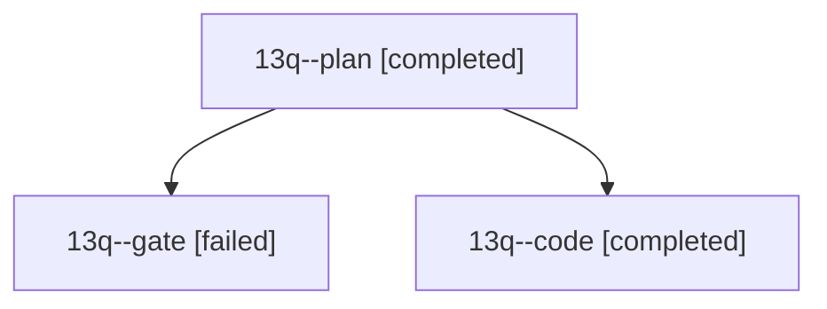

# Session: 13q

[Agent Hoods](../README.md) / [bbugyi200](../users/bbugyi200/README.md) / [athena](../users/bbugyi200/machines/athena/README.md) / [13q](../users/bbugyi200/machines/athena/hoods/13q/README.md) / 13q

Owner: `bbugyi200.athena` · Hood: `13q` · Members: 3

## Lineage

The diagram is an optional enhancement; the ordered table below contains the same lineage in accessible text.

| Role | Agent | State | Model / provider | Timing | Commits | Prompt | Chat |
|---|---|---|---|---|---:|---|---|
| plan | 13q--plan | completed | opus / claude | 2026-10-24T15:03:32.940106+00:00 → 2026-10-24T15:40:04.434053+00:00 | 0 | [Prompt](../agents/bbugyi200.athena.13q--plan/prompt.md) | [Chat](../agents/bbugyi200.athena.13q--plan/chat.md) |
| gate | 13q--gate | failed | opus / claude | 2026-10-24T15:19:18.687026+00:00 → 2026-10-24T15:20:29.397589+00:00 | 0 | — | [Chat](../agents/bbugyi200.athena.13q--gate/chat.md) |
| code | 13q--code | completed | muse-spark-1.3-contributor / muse | 2026-10-24T15:20:33.167781+00:00 → 2026-10-24T15:40:04.434053+00:00 | [1](../agents/bbugyi200.athena.13q--code/README.md#commits) | — | [Chat](../agents/bbugyi200.athena.13q--code/chat.md) |

## Commits

| Role | Repo | Commit | Subject | Committed |
|---|---|---|---|---|
| code | bob-cli | [`ae3a432`](https://github.com/bobs-org/bob-cli/commit/ae3a432b29be1c8fdc58e6b77bfdd1673368d236) | fix(ref): cap tall Mermaid diagrams at 80% text height | 2026-10-24 11:38:40 EDT |
