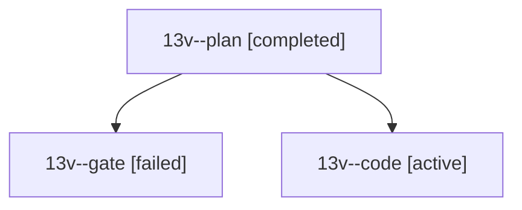

# Session: 13v

[Agent Hoods](../README.md) / [bbugyi200](../users/bbugyi200/README.md) / [athena](../users/bbugyi200/machines/athena/README.md) / [13v](../users/bbugyi200/machines/athena/hoods/13v/README.md) / 13v

Owner: `bbugyi200.athena` · Hood: `13v` · Members: 3

## Lineage

The diagram is an optional enhancement; the ordered table below contains the same lineage in accessible text.

| Role | Agent | State | Model / provider | Timing | Commits | Prompt | Chat |
|---|---|---|---|---|---:|---|---|
| plan | 13v--plan | completed | opus / claude | 2026-10-24T19:19:22.993244+00:00 → 2026-10-24T19:30:33.903378+00:00 | 0 | [Prompt](../agents/bbugyi200.athena.13v--plan/prompt.md) | [Chat](../agents/bbugyi200.athena.13v--plan/chat.md) |
| gate | 13v--gate | failed | opus / claude | 2026-10-24T19:29:51.421331+00:00 → 2026-10-24T19:35:16.553325+00:00 | 0 | — | [Chat](../agents/bbugyi200.athena.13v--gate/chat.md) |
| code | 13v--code | active | muse-spark-1.3-contributor / muse | 2026-10-24T19:36:23.060193+00:00 | [1](../agents/bbugyi200.athena.13v--code/README.md#commits) | [Prompt](../agents/bbugyi200.athena.13v--code/prompt.md) | — |

## Commits

| Role | Repo | Commit | Subject | Committed |
|---|---|---|---|---|
| code | bob-cli | [`7389784`](https://github.com/bobs-org/bob-cli/commit/7389784f7a49d2a617caceb28110b2f5620acb0f) | feat(highlights-ref): join annotation sections with #name tags | 2026-10-24 16:01:42 EDT |
