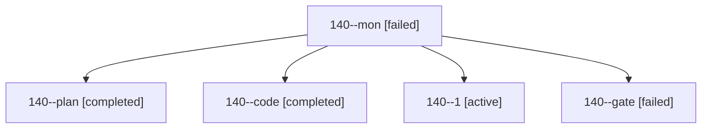

# Session: 140

[Agent Hoods](../README.md) / [bbugyi200](../users/bbugyi200/README.md) / [athena](../users/bbugyi200/machines/athena/README.md) / [140](../users/bbugyi200/machines/athena/hoods/140/README.md) / 140

Owner: `bbugyi200.athena` · Hood: `140` · Members: 5

## Lineage



The diagram is an optional enhancement; the ordered table below contains the same lineage in accessible text.

| Role | Agent | State | Model / provider | Timing | Commits | Prompt | Chat |
|---|---|---|---|---|---:|---|---|
| <a id="member-mon"></a>mon | 140--mon | failed | gpt-6-luna / codex | 2026-10-24T21:57:17.384065+00:00 → 2026-10-24T22:01:09.916193+00:00 | 0 | — | [Chat](../agents/bbugyi200.athena.140--mon/chat.md) |
| <a id="member-plan"></a>plan | 140--plan | completed | opus / claude | 2026-10-24T21:16:56.897126+00:00 → 2026-10-24T21:30:47.224720+00:00 | 0 | [Prompt](../agents/bbugyi200.athena.140--plan/prompt.md) | [Chat](../agents/bbugyi200.athena.140--plan/chat.md) |
| <a id="member-code"></a>code | 140--code | completed | gpt-6-luna / codex | 2026-10-24T21:39:54.021414+00:00 → 2026-10-24T21:58:05.754428+00:00 | 0 | [Prompt](../agents/bbugyi200.athena.140--code/prompt.md) | [Chat](../agents/bbugyi200.athena.140--code/chat.md) |
| <a id="member-1"></a>1 | 140--1 | active | gpt-6-luna / codex | 2026-10-24T22:02:08.901186+00:00 | [1](../agents/bbugyi200.athena.140--1/README.md#commits) | [Prompt](../agents/bbugyi200.athena.140--1/prompt.md) | — |
| <a id="member-gate"></a>gate | 140--gate | failed | opus / claude | 2026-10-24T21:38:29.733302+00:00 → 2026-10-24T21:39:13.164962+00:00 | 0 | — | [Chat](../agents/bbugyi200.athena.140--gate/chat.md) |

## Commits

| Role | Repo | Commit | Subject | Committed |
|---|---|---|---|---|
| 1 | bob-cli | [`3bc7e45`](https://github.com/bobs-org/bob-cli/commit/3bc7e45e1b0b33f0cd5a11d50c9bb50cee0c4fe0) | fix(listen): warn when a listen episode is queued instead of published | 2026-10-24 18:13:15 EDT |

## Variables

| Role | Variable | Value |
|---|---|---|
| 1 | `artifacts` | \[{kind: markdown, label: Pending feed publish manifest gap, path: /home/bryan/.sase/artifacts/agents/gh\_bobs-org\_\_bob-cli/20261024180009/listen-publish-manifest-gap-e85baf0e1180.md, ref: file:explici… |

#### artifacts

**Role:** `1`

```yaml
- kind: markdown
  label: Pending feed publish manifest gap
  path: /home/bryan/.sase/artifacts/agents/gh_bobs-org__bob-cli/20261024180009/listen-publish-manifest-gap-e85baf0e1180.md
  ref: file:explicit:00bc4d30e4c479e99af34971
  source_path: /home/bryan/.local/state/sase/workspaces/bobs-org/bob-cli/bob-cli_11/target/listen-publish-manifest-gap.md
```

Values are truncated for display; see each member's agent meta.json for the full values.
