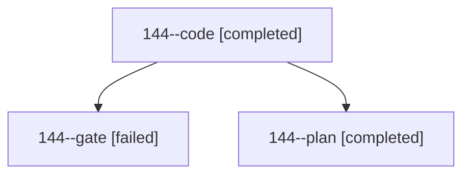

# Session: 144

[Agent Hoods](../README.md) / [bbugyi200](../users/bbugyi200/README.md) / [athena](../users/bbugyi200/machines/athena/README.md) / [144](../users/bbugyi200/machines/athena/hoods/144/README.md) / 144

Owner: `bbugyi200.athena` · Hood: `144` · Members: 3

## Lineage



The diagram is an optional enhancement; the ordered table below contains the same lineage in accessible text.

| Role | Agent | State | Model / provider | Timing | Commits | Prompt | Chat |
|---|---|---|---|---|---:|---|---|
| <a id="member-code"></a>code | 144--code | completed | muse-spark-1.3-contributor / muse | 2026-10-25T13:47:12.276223+00:00 → 2026-10-25T14:03:34.485608+00:00 | 0 | [Prompt](../agents/bbugyi200.athena.144--code/prompt.md) | [Chat](../agents/bbugyi200.athena.144--code/chat.md) |
| <a id="member-gate"></a>gate | 144--gate | failed | opus / claude | 2026-10-25T13:44:31.705399+00:00 → 2026-10-25T13:45:29.345030+00:00 | 0 | — | [Chat](../agents/bbugyi200.athena.144--gate/chat.md) |
| <a id="member-plan"></a>plan | 144--plan | completed | opus / claude | 2026-10-25T13:29:02.039426+00:00 → 2026-10-25T13:40:20.669025+00:00 | 0 | [Prompt](../agents/bbugyi200.athena.144--plan/prompt.md) | [Chat](../agents/bbugyi200.athena.144--plan/chat.md) |

## Variables

| Role | Variable | Value |
|---|---|---|
| code | `artifacts` | \[{kind: image, label: Day strip under badges with so far 10:00, Mac verify, path: /home/bryan/.sase/artifacts/agents/gh\_bobs-org\_\_bob-cli/20261025094529/day-strip-today2-e0f1a7d55940.png, ref: file:e… |

#### artifacts

**Role:** `code`

```yaml
- kind: image
  label: Day strip under badges with so far 10:00, Mac verify
  path: /home/bryan/.sase/artifacts/agents/gh_bobs-org__bob-cli/20261025094529/day-strip-today2-e0f1a7d55940.png
  ref: file:explicit:80798112b1b24ae5607c3a71
  source_path: /tmp/day-strip-today2.png
```

Values are truncated for display; see each member's agent meta.json for the full values.
