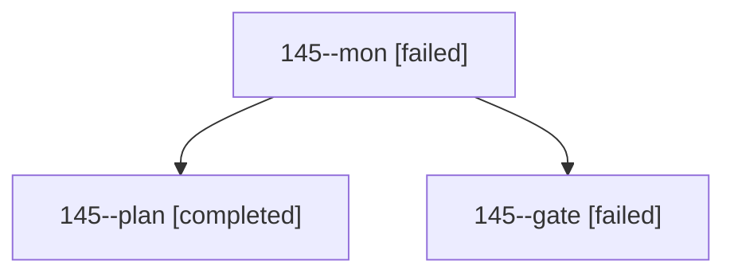

# Session: 145

[Agent Hoods](../README.md) / [bbugyi200](../users/bbugyi200/README.md) / [athena](../users/bbugyi200/machines/athena/README.md) / [145](../users/bbugyi200/machines/athena/hoods/145/README.md) / 145

Owner: `bbugyi200.athena` · Hood: `145` · Members: 3

## Lineage



The diagram is an optional enhancement; the ordered table below contains the same lineage in accessible text.

| Role | Agent | State | Model / provider | Timing | Commits | Prompt | Chat |
|---|---|---|---|---|---:|---|---|
| <a id="member-mon"></a>mon | 145--mon | failed | opus / claude | 2026-10-25T14:27:17.480991+00:00 → 2026-10-25T14:30:15.663566+00:00 | 0 | — | [Chat](../agents/bbugyi200.athena.145--mon/chat.md) |
| <a id="member-plan"></a>plan | 145--plan | completed | opus / claude | 2026-10-25T14:06:11.733732+00:00 → 2026-10-25T14:26:11.233201+00:00 | 0 | [Prompt](../agents/bbugyi200.athena.145--plan/prompt.md) | [Chat](../agents/bbugyi200.athena.145--plan/chat.md) |
| <a id="member-gate"></a>gate | 145--gate | failed | opus / claude | 2026-10-25T14:26:39.568863+00:00 → 2026-10-25T14:27:20.093079+00:00 | 0 | — | [Chat](../agents/bbugyi200.athena.145--gate/chat.md) |

## Variables

| Role | Variable | Value |
|---|---|---|
| plan | `artifacts` | \[{kind: image, label: Mockup: Day strip above the badges, full-width root-parent bar as separator (light/dark, 700/540/410, past, empty, skeleton), path: /home/bryan/.sase/artifacts/agents/gh\_bobs-or… |

#### artifacts

**Role:** `plan`

```yaml
- kind: image
  label: Mockup: Day strip above the badges, full-width root-parent bar as separator (light/dark, 700/540/410, past, empty, skeleton)
  path: /home/bryan/.sase/artifacts/agents/gh_bobs-org__bob-cli/20261025100530/daily-df2456da4995.png
  ref: file:explicit:0142f95e874aea8dd9c54b03
  source_path: /tmp/day_strip_mock_12/daily.png
- kind: image
  label: Mockup: Stats dash Where the time went, Root parents view grouped by area with sub-project disclosure
  path: /home/bryan/.sase/artifacts/agents/gh_bobs-org__bob-cli/20261025100530/dash-01f66634b91a.png
  ref: file:explicit:586e90f4b27e75bb67c147b2
  source_path: /tmp/day_strip_mock_12/dash.png
- kind: file
  label: Mockup generator (proposed strip and Root parents CSS/DOM) for the Day strip above badges
  path: /home/bryan/.sase/artifacts/agents/gh_bobs-org__bob-cli/20261025100530/make_mock-fc588529d822.py
  ref: file:explicit:2fb991e812b955b23e2dc601
  source_path: /tmp/day_strip_mock_scripts_12/make_mock.py
```

Values are truncated for display; see each member's agent meta.json for the full values.

## Neighbors

| Agent | Relation | State |
|---|---|---|
| [145.w0](../agents/bbugyi200.athena.145.w0/README.md) | descendant | active |
| [145.w1](../agents/bbugyi200.athena.145.w1/README.md) | descendant | active |
| [145.w2](../agents/bbugyi200.athena.145.w2/README.md) | descendant | active |
| [145.w3](../agents/bbugyi200.athena.145.w3/README.md) | descendant | active |
| [145.w4](../agents/bbugyi200.athena.145.w4/README.md) | descendant | active |
| [145.w5](../agents/bbugyi200.athena.145.w5/README.md) | descendant | active |
| [145.w6](bbugyi200.athena.145.w6.md) (session · 3) | descendant | active 2, failed 1 |
