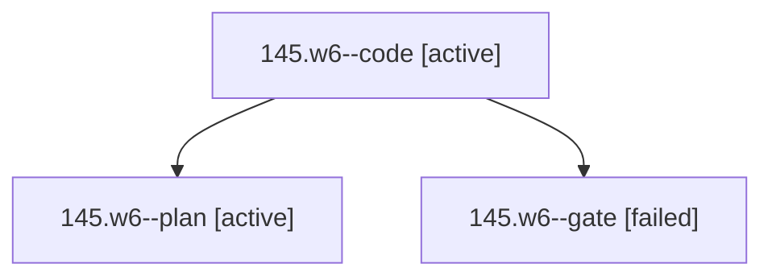

# Session: 145.w6

[Agent Hoods](../README.md) / [bbugyi200](../users/bbugyi200/README.md) / [athena](../users/bbugyi200/machines/athena/README.md) / [145](../users/bbugyi200/machines/athena/hoods/145/README.md) / 145.w6

Owner: `bbugyi200.athena` · Hood: `145` · Members: 3

## Lineage

The diagram is an optional enhancement; the ordered table below contains the same lineage in accessible text.

| Role | Agent | State | Model / provider | Timing | Commits | Prompt | Chat |
|---|---|---|---|---|---:|---|---|
| code | 145.w6--code | active | muse-spark-1.3-contributor / muse | 2026-10-25T17:08:36.171890+00:00 | [1](../agents/bbugyi200.athena.145.w6--code/README.md#commits) | — | — |
| plan | 145.w6--plan | active | opus / claude | 2026-10-25T16:53:23.826721+00:00 | 0 | [Prompt](../agents/bbugyi200.athena.145.w6--plan/prompt.md) | [Chat](../agents/bbugyi200.athena.145.w6--plan/chat.md) |
| gate | 145.w6--gate | failed | opus / claude | 2026-10-25T17:07:54.647889+00:00 → 2026-10-25T17:08:23.453512+00:00 | 0 | — | [Chat](../agents/bbugyi200.athena.145.w6--gate/chat.md) |

## Commits

| Role | Repo | Commit | Subject | Committed |
|---|---|---|---|---|
| code | bob-cli | [`5384319`](https://github.com/bobs-org/bob-cli/commit/5384319e25cd0255ea83be93f9529a24d89703c7) | docs(cli): describe day strip stacked stat row with muted stale values | 2026-10-25 13:19:12 EDT |

## Neighbors

| Agent | Relation | State |
|---|---|---|
| [145](bbugyi200.athena.145.md) (session · 3) | ancestor | completed 1, failed 2 |
| [145.w0](../agents/bbugyi200.athena.145.w0/README.md) | 145 hood | active |
| [145.w1](../agents/bbugyi200.athena.145.w1/README.md) | 145 hood | active |
| [145.w2](../agents/bbugyi200.athena.145.w2/README.md) | 145 hood | active |
| [145.w3](../agents/bbugyi200.athena.145.w3/README.md) | 145 hood | active |
| [145.w4](../agents/bbugyi200.athena.145.w4/README.md) | 145 hood | active |
| [145.w5](../agents/bbugyi200.athena.145.w5/README.md) | 145 hood | active |
