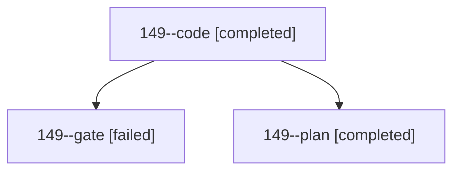

# Session: 149

[Agent Hoods](../README.md) / [bbugyi200](../users/bbugyi200/README.md) / [athena](../users/bbugyi200/machines/athena/README.md) / [149](../users/bbugyi200/machines/athena/hoods/149/README.md) / 149

Owner: `bbugyi200.athena` · Hood: `149` · Members: 3

## Lineage

The diagram is an optional enhancement; the ordered table below contains the same lineage in accessible text.

| Role | Agent | State | Model / provider | Timing | Commits | Prompt | Chat |
|---|---|---|---|---|---:|---|---|
| code | 149--code | completed | muse-spark-1.3-contributor / muse | 2026-10-25T17:51:40.984808+00:00 → 2026-10-25T17:58:14.559924+00:00 | 0 | [Prompt](../agents/bbugyi200.athena.149--code/prompt.md) | [Chat](../agents/bbugyi200.athena.149--code/chat.md) |
| gate | 149--gate | failed | opus / claude | 2026-10-25T17:49:51.991165+00:00 → 2026-10-25T17:50:56.442138+00:00 | 0 | — | [Chat](../agents/bbugyi200.athena.149--gate/chat.md) |
| plan | 149--plan | completed | opus / claude | 2026-10-25T17:46:37.405609+00:00 → 2026-10-25T17:50:10.795379+00:00 | 0 | [Prompt](../agents/bbugyi200.athena.149--plan/prompt.md) | [Chat](../agents/bbugyi200.athena.149--plan/chat.md) |
