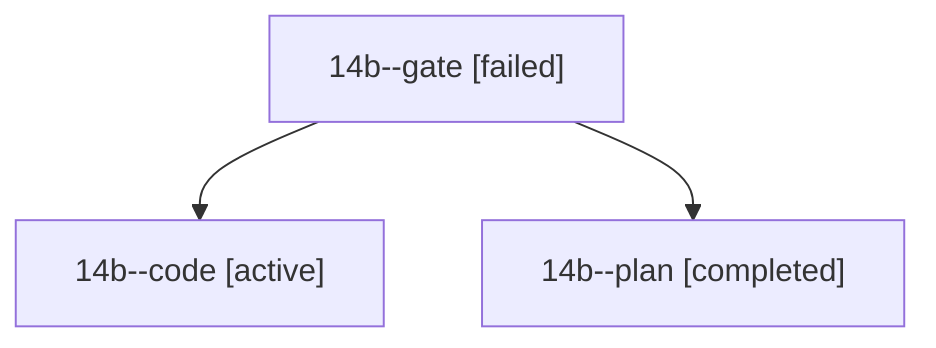

# Session: 14b

[Agent Hoods](../README.md) / [bbugyi200](../users/bbugyi200/README.md) / [athena](../users/bbugyi200/machines/athena/README.md) / [14b](../users/bbugyi200/machines/athena/hoods/14b/README.md) / 14b

Owner: `bbugyi200.athena` · Hood: `14b` · Members: 3

## Lineage

The diagram is an optional enhancement; the ordered table below contains the same lineage in accessible text.

| Role | Agent | State | Model / provider | Timing | Commits | Prompt | Chat |
|---|---|---|---|---|---:|---|---|
| gate | 14b--gate | failed | opus / claude | 2026-10-25T18:54:24.769789+00:00 → 2026-10-25T18:55:28.591222+00:00 | 0 | — | [Chat](../agents/bbugyi200.athena.14b--gate/chat.md) |
| code | 14b--code | active | muse-spark-1.3-contributor / muse | 2026-10-25T18:56:12.249156+00:00 | 0 | [Prompt](../agents/bbugyi200.athena.14b--code/prompt.md) | — |
| plan | 14b--plan | completed | opus / claude | 2026-10-25T18:34:48.872376+00:00 → 2026-10-25T18:47:08.434469+00:00 | 0 | [Prompt](../agents/bbugyi200.athena.14b--plan/prompt.md) | [Chat](../agents/bbugyi200.athena.14b--plan/chat.md) |
