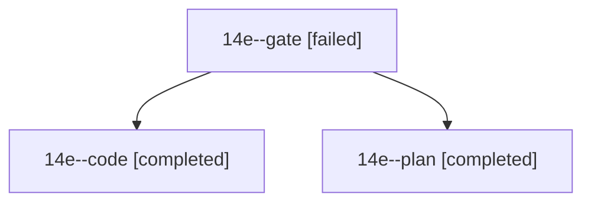

# Session: 14e

[Agent Hoods](../README.md) / [bbugyi200](../users/bbugyi200/README.md) / [athena](../users/bbugyi200/machines/athena/README.md) / [14e](../users/bbugyi200/machines/athena/hoods/14e/README.md) / 14e

Owner: `bbugyi200.athena` · Hood: `14e` · Members: 3

## Lineage

The diagram is an optional enhancement; the ordered table below contains the same lineage in accessible text.

| Role | Agent | State | Model / provider | Timing | Commits | Prompt | Chat |
|---|---|---|---|---|---:|---|---|
| gate | 14e--gate | failed | opus / claude | 2026-10-25T20:06:20.622025+00:00 → 2026-10-25T20:08:35.660636+00:00 | 0 | — | [Chat](../agents/bbugyi200.athena.14e--gate/chat.md) |
| code | 14e--code | completed | muse-spark-1.3-contributor / muse | 2026-10-25T20:09:30.003665+00:00 → 2026-10-25T20:23:00.315477+00:00 | [1](../agents/bbugyi200.athena.14e--code/README.md#commits) | [Prompt](../agents/bbugyi200.athena.14e--code/prompt.md) | — |
| plan | 14e--plan | completed | opus / claude | 2026-10-25T19:48:47.640045+00:00 → 2026-10-25T19:59:54.982852+00:00 | 0 | [Prompt](../agents/bbugyi200.athena.14e--plan/prompt.md) | [Chat](../agents/bbugyi200.athena.14e--plan/chat.md) |

## Commits

| Role | Repo | Commit | Subject | Committed |
|---|---|---|---|---|
| code | — | `55334b0` | fix(ref): number Markdown sections from the top heading level | 2026-10-25 16:21:57 EDT |
