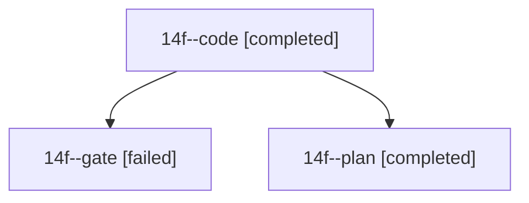

# Session: 14f

[Agent Hoods](../README.md) / [bbugyi200](../users/bbugyi200/README.md) / [athena](../users/bbugyi200/machines/athena/README.md) / [14f](../users/bbugyi200/machines/athena/hoods/14f/README.md) / 14f

Owner: `bbugyi200.athena` · Hood: `14f` · Members: 3

## Lineage

The diagram is an optional enhancement; the ordered table below contains the same lineage in accessible text.

| Role | Agent | State | Model / provider | Timing | Commits | Prompt | Chat |
|---|---|---|---|---|---:|---|---|
| code | 14f--code | completed | muse-spark-1.3-contributor / muse | 2026-10-26T09:29:39.801180+00:00 → 2026-10-26T09:46:12.341581+00:00 | [1](../agents/bbugyi200.athena.14f--code/README.md#commits) | [Prompt](../agents/bbugyi200.athena.14f--code/prompt.md) | — |
| gate | 14f--gate | failed | opus / claude | 2026-10-26T09:28:04.977058+00:00 → 2026-10-26T09:28:52.400121+00:00 | 0 | — | [Chat](../agents/bbugyi200.athena.14f--gate/chat.md) |
| plan | 14f--plan | completed | opus / claude | 2026-10-26T09:18:57.570707+00:00 → 2026-10-26T09:26:42.742402+00:00 | 0 | [Prompt](../agents/bbugyi200.athena.14f--plan/prompt.md) | [Chat](../agents/bbugyi200.athena.14f--plan/chat.md) |

## Commits

| Role | Repo | Commit | Subject | Committed |
|---|---|---|---|---|
| code | — | `17f3881` | feat(homes): let root: true make a project its own root parent | 2026-10-26 05:45:06 EDT |
