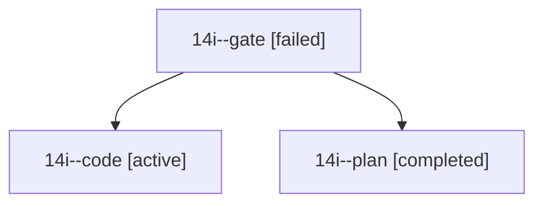

# Session: 14i

[Agent Hoods](../README.md) / [bbugyi200](../users/bbugyi200/README.md) / [athena](../users/bbugyi200/machines/athena/README.md) / [14i](../users/bbugyi200/machines/athena/hoods/14i/README.md) / 14i

Owner: `bbugyi200.athena` · Hood: `14i` · Members: 3

## Lineage

The diagram is an optional enhancement; the ordered table below contains the same lineage in accessible text.

| Role | Agent | State | Model / provider | Timing | Commits | Prompt | Chat |
|---|---|---|---|---|---:|---|---|
| gate | 14i--gate | failed | opus / claude | 2026-10-26T12:47:00.293147+00:00 → 2026-10-26T12:50:27.912340+00:00 | 0 | — | [Chat](../agents/bbugyi200.athena.14i--gate/chat.md) |
| code | 14i--code | active | muse-spark-1.3-contributor / muse | 2026-10-26T12:51:16.037289+00:00 | [1](../agents/bbugyi200.athena.14i--code/README.md#commits) | [Prompt](../agents/bbugyi200.athena.14i--code/prompt.md) | — |
| plan | 14i--plan | completed | opus / claude | 2026-10-26T12:33:41.132521+00:00 → 2026-10-26T12:47:54.248581+00:00 | 0 | [Prompt](../agents/bbugyi200.athena.14i--plan/prompt.md) | [Chat](../agents/bbugyi200.athena.14i--plan/chat.md) |

## Commits

| Role | Repo | Commit | Subject | Committed |
|---|---|---|---|---|
| code | bob-cli | [`69dfd7e`](https://github.com/bobs-org/bob-cli/commit/69dfd7e8052de50c96f2013f34871810632095b9) | feat(stats): name more root parents in day-strip legend via short\_label | 2026-10-26 09:13:21 EDT |
