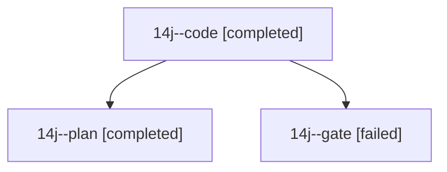

# Session: 14j

[Agent Hoods](../README.md) / [bbugyi200](../users/bbugyi200/README.md) / [athena](../users/bbugyi200/machines/athena/README.md) / [14j](../users/bbugyi200/machines/athena/hoods/14j/README.md) / 14j

Owner: `bbugyi200.athena` · Hood: `14j` · Members: 3

## Lineage

The diagram is an optional enhancement; the ordered table below contains the same lineage in accessible text.

| Role | Agent | State | Model / provider | Timing | Commits | Prompt | Chat |
|---|---|---|---|---|---:|---|---|
| code | 14j--code | completed | grok-4.6 / grok | 2026-10-26T15:02:10.227946+00:00 → 2026-10-26T15:22:26.040751+00:00 | [1](../agents/bbugyi200.athena.14j--code/README.md#commits) | [Prompt](../agents/bbugyi200.athena.14j--code/prompt.md) | [Chat](../agents/bbugyi200.athena.14j--code/chat.md) |
| plan | 14j--plan | completed | opus / claude | 2026-10-26T14:49:08.185865+00:00 → 2026-10-26T15:00:00.282665+00:00 | 0 | [Prompt](../agents/bbugyi200.athena.14j--plan/prompt.md) | [Chat](../agents/bbugyi200.athena.14j--plan/chat.md) |
| gate | 14j--gate | failed | opus / claude | 2026-10-26T15:00:05.285475+00:00 → 2026-10-26T15:01:06.679578+00:00 | 0 | — | [Chat](../agents/bbugyi200.athena.14j--gate/chat.md) |

## Commits

| Role | Repo | Commit | Subject | Committed |
|---|---|---|---|---|
| code | bob-cli | [`cbd2ee0`](https://github.com/bobs-org/bob-cli/commit/cbd2ee0515ab1da4f4b66b0d8b4b04921e85114d) | docs(stats): document Day strip boolean status marks | 2026-10-26 11:20:31 EDT |
