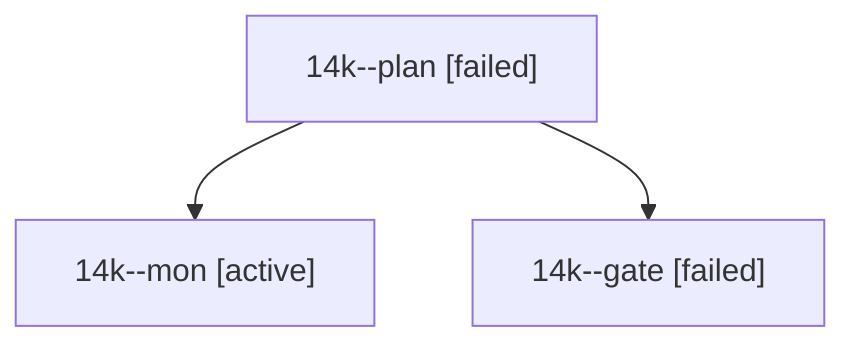

# Session: 14k

[Agent Hoods](../README.md) / [bbugyi200](../users/bbugyi200/README.md) / [athena](../users/bbugyi200/machines/athena/README.md) / [14k](../users/bbugyi200/machines/athena/hoods/14k/README.md) / 14k

Owner: `bbugyi200.athena` · Hood: `14k` · Members: 3

## Lineage

The diagram is an optional enhancement; the ordered table below contains the same lineage in accessible text.

| Role | Agent | State | Model / provider | Timing | Commits | Prompt | Chat |
|---|---|---|---|---|---:|---|---|
| plan | 14k--plan | failed | opus / claude | 2026-10-26T19:17:33.748529+00:00 → 2026-10-26T19:37:33.226537+00:00 | 0 | [Prompt](../agents/bbugyi200.athena.14k--plan/prompt.md) | [Chat](../agents/bbugyi200.athena.14k--plan/chat.md) |
| mon | 14k--mon | active | opus / claude | 2026-10-26T19:37:22.082533+00:00 | 0 | — | — |
| gate | 14k--gate | failed | opus / claude | 2026-10-26T19:36:27.299419+00:00 → 2026-10-26T19:37:22.685444+00:00 | 0 | — | [Chat](../agents/bbugyi200.athena.14k--gate/chat.md) |

## Neighbors

| Agent | Relation | State |
|---|---|---|
| [14k.w0](../agents/bbugyi200.athena.14k.w0/README.md) | descendant | waiting |
