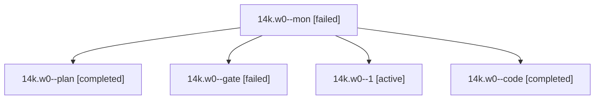

# Session: 14k.w0

[Agent Hoods](../README.md) / [bbugyi200](../users/bbugyi200/README.md) / [athena](../users/bbugyi200/machines/athena/README.md) / [14k](../users/bbugyi200/machines/athena/hoods/14k/README.md) / 14k.w0

Owner: `bbugyi200.athena` · Hood: `14k` · Members: 5

## Lineage

The diagram is an optional enhancement; the ordered table below contains the same lineage in accessible text.

| Role | Agent | State | Model / provider | Timing | Commits | Prompt | Chat |
|---|---|---|---|---|---:|---|---|
| mon | 14k.w0--mon | failed | gpt-6-luna / codex | 2026-10-27T02:28:31.284309+00:00 → 2026-10-27T02:32:56.798061+00:00 | 0 | — | [Chat](../agents/bbugyi200.athena.14k.w0--mon/chat.md) |
| plan | 14k.w0--plan | completed | opus / claude | 2026-10-27T01:56:38.500885+00:00 → 2026-10-27T02:30:24.167185+00:00 | 0 | [Prompt](../agents/bbugyi200.athena.14k.w0--plan/prompt.md) | [Chat](../agents/bbugyi200.athena.14k.w0--plan/chat.md) |
| gate | 14k.w0--gate | failed | opus / claude | 2026-10-27T02:08:26.755077+00:00 → 2026-10-27T02:09:20.280309+00:00 | 0 | — | [Chat](../agents/bbugyi200.athena.14k.w0--gate/chat.md) |
| 1 | 14k.w0--1 | active | gpt-6-luna / codex | 2026-10-27T02:33:47.969723+00:00 | 0 | [Prompt](../agents/bbugyi200.athena.14k.w0--1/prompt.md) | — |
| code | 14k.w0--code | completed | gpt-6-luna / codex | 2026-10-27T02:09:33.851287+00:00 → 2026-10-27T02:30:24.167185+00:00 | 0 | — | [Chat](../agents/bbugyi200.athena.14k.w0--code/chat.md) |

## Neighbors

| Agent | Relation | State |
|---|---|---|
| [14k](bbugyi200.athena.14k.md) (session · 3) | ancestor | failed 3 |
