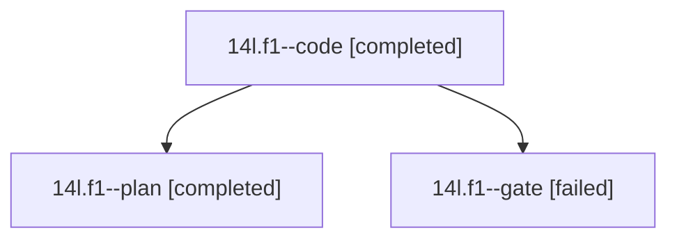

# Session: 14l.f1

[Agent Hoods](../README.md) / [bbugyi200](../users/bbugyi200/README.md) / [athena](../users/bbugyi200/machines/athena/README.md) / [14l](../users/bbugyi200/machines/athena/hoods/14l/README.md) / 14l.f1

Owner: `bbugyi200.athena` · Hood: `14l` · Members: 3

## Lineage

The diagram is an optional enhancement; the ordered table below contains the same lineage in accessible text.

| Role | Agent | State | Model / provider | Timing | Commits | Prompt | Chat |
|---|---|---|---|---|---:|---|---|
| code | 14l.f1--code | completed | muse-spark-1.3-contributor / muse | 2026-10-26T17:17:33.621712+00:00 → 2026-10-26T17:53:30.933409+00:00 | [1](../agents/bbugyi200.athena.14l.f1--code/README.md#commits) | [Prompt](../agents/bbugyi200.athena.14l.f1--code/prompt.md) | [Chat](../agents/bbugyi200.athena.14l.f1--code/chat.md) |
| plan | 14l.f1--plan | completed | opus / claude | 2026-10-26T16:48:04.035285+00:00 → 2026-10-26T16:57:55.249441+00:00 | 0 | [Prompt](../agents/bbugyi200.athena.14l.f1--plan/prompt.md) | [Chat](../agents/bbugyi200.athena.14l.f1--plan/chat.md) |
| gate | 14l.f1--gate | failed | opus / claude | 2026-10-26T16:57:22.646889+00:00 → 2026-10-26T17:05:40.610889+00:00 | 0 | — | [Chat](../agents/bbugyi200.athena.14l.f1--gate/chat.md) |

## Commits

| Role | Repo | Commit | Subject | Committed |
|---|---|---|---|---|
| code | bob-cli | [`c048955`](https://github.com/bobs-org/bob-cli/commit/c0489557988b49837f5afd354ac6d018dccc39f1) | feat(day-strip): document bars switch and update glossary | 2026-10-26 13:39:58 EDT |

## Neighbors

| Agent | Relation | State |
|---|---|---|
| [14l](bbugyi200.athena.14l.md) (session · 3) | ancestor | completed 2, failed 1 |
| [14l.f0](../agents/bbugyi200.athena.14l.f0/README.md) | 14l hood | active |
| [14l.w0](../agents/bbugyi200.athena.14l.w0/README.md) | 14l hood | active |
