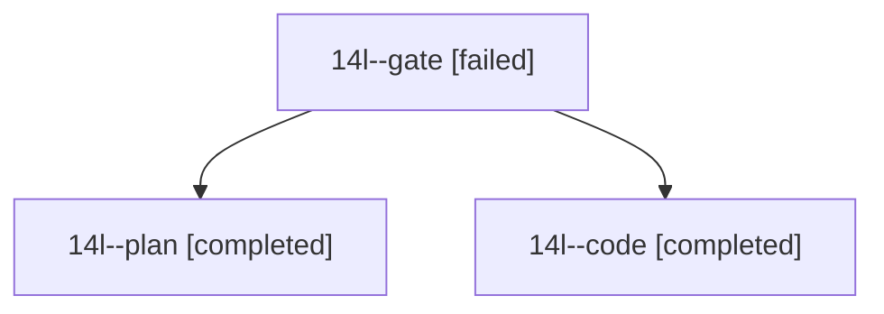

# Session: 14l

[Agent Hoods](../README.md) / [bbugyi200](../users/bbugyi200/README.md) / [athena](../users/bbugyi200/machines/athena/README.md) / [14l](../users/bbugyi200/machines/athena/hoods/14l/README.md) / 14l

Owner: `bbugyi200.athena` · Hood: `14l` · Members: 3

## Lineage

The diagram is an optional enhancement; the ordered table below contains the same lineage in accessible text.

| Role | Agent | State | Model / provider | Timing | Commits | Prompt | Chat |
|---|---|---|---|---|---:|---|---|
| gate | 14l--gate | failed | opus / claude | 2026-10-26T15:46:11.582184+00:00 → 2026-10-26T15:47:29.519455+00:00 | 0 | — | [Chat](../agents/bbugyi200.athena.14l--gate/chat.md) |
| plan | 14l--plan | completed | opus / claude | 2026-10-26T15:29:07.982295+00:00 → 2026-10-26T15:45:38.558102+00:00 | 0 | [Prompt](../agents/bbugyi200.athena.14l--plan/prompt.md) | [Chat](../agents/bbugyi200.athena.14l--plan/chat.md) |
| code | 14l--code | completed | grok-4.6 / grok | 2026-10-26T15:48:14.698970+00:00 → 2026-10-26T16:34:29.110376+00:00 | [1](../agents/bbugyi200.athena.14l--code/README.md#commits) | [Prompt](../agents/bbugyi200.athena.14l--code/prompt.md) | [Chat](../agents/bbugyi200.athena.14l--code/chat.md) |

## Commits

| Role | Repo | Commit | Subject | Committed |
|---|---|---|---|---|
| code | bob-cli | [`5e8c6ec`](https://github.com/bobs-org/bob-cli/commit/5e8c6ecde26f41a2962cba81ef4a869984b04166) | docs(stats): describe the Day strip theme lane | 2026-10-26 12:24:25 EDT |

## Neighbors

| Agent | Relation | State |
|---|---|---|
| [14l.f0](../agents/bbugyi200.athena.14l.f0/README.md) | descendant | active |
| [14l.f1](../agents/bbugyi200.athena.14l.f1/README.md) | descendant | active |
| [14l.w0](../agents/bbugyi200.athena.14l.w0/README.md) | descendant | active |
