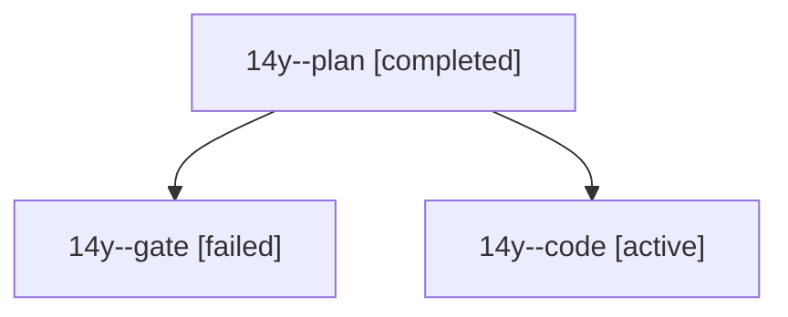

# Session: 14y

[Agent Hoods](../README.md) / [bbugyi200](../users/bbugyi200/README.md) / [athena](../users/bbugyi200/machines/athena/README.md) / [14y](../users/bbugyi200/machines/athena/hoods/14y/README.md) / 14y

Owner: `bbugyi200.athena` · Hood: `14y` · Members: 3

## Lineage

The diagram is an optional enhancement; the ordered table below contains the same lineage in accessible text.

| Role | Agent | State | Model / provider | Timing | Commits | Prompt | Chat |
|---|---|---|---|---|---:|---|---|
| plan | 14y--plan | completed | opus / claude | 2026-10-28T10:51:58.890450+00:00 → 2026-10-28T10:58:46.468310+00:00 | 0 | [Prompt](../agents/bbugyi200.athena.14y--plan/prompt.md) | [Chat](../agents/bbugyi200.athena.14y--plan/chat.md) |
| gate | 14y--gate | failed | opus / claude | 2026-10-28T10:58:44.121623+00:00 → 2026-10-28T11:00:34.261016+00:00 | 0 | — | [Chat](../agents/bbugyi200.athena.14y--gate/chat.md) |
| code | 14y--code | active | grok-4.6 / grok | 2026-10-28T11:02:14.593875+00:00 | [1](../agents/bbugyi200.athena.14y--code/README.md#commits) | [Prompt](../agents/bbugyi200.athena.14y--code/prompt.md) | — |

## Commits

| Role | Repo | Commit | Subject | Committed |
|---|---|---|---|---|
| code | bob-cli | [`9849b7c`](https://github.com/bobs-org/bob-cli/commit/9849b7cb8d6a6c0e4415924c0924f65695679053) | fix(homes): label the daily root parent GTD | 2026-10-28 07:22:35 EDT |
