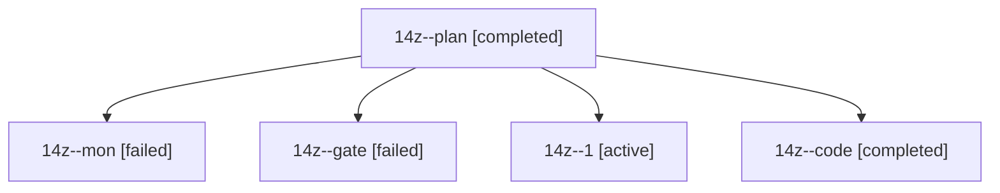

# Session: 14z

[Agent Hoods](../README.md) / [bbugyi200](../users/bbugyi200/README.md) / [athena](../users/bbugyi200/machines/athena/README.md) / [14z](../users/bbugyi200/machines/athena/hoods/14z/README.md) / 14z

Owner: `bbugyi200.athena` · Hood: `14z` · Members: 5

## Lineage

The diagram is an optional enhancement; the ordered table below contains the same lineage in accessible text.

| Role | Agent | State | Model / provider | Timing | Commits | Prompt | Chat |
|---|---|---|---|---|---:|---|---|
| plan | 14z--plan | completed | opus / claude | 2026-10-28T10:56:32.234931+00:00 → 2026-10-28T11:03:02.732595+00:00 | 0 | [Prompt](../agents/bbugyi200.athena.14z--plan/prompt.md) | [Chat](../agents/bbugyi200.athena.14z--plan/chat.md) |
| mon | 14z--mon | failed | muse-spark-1.3-contributor / muse | 2026-10-28T11:18:31.128934+00:00 → 2026-10-28T11:26:14.062114+00:00 | 0 | — | [Chat](../agents/bbugyi200.athena.14z--mon/chat.md) |
| gate | 14z--gate | failed | opus / claude | 2026-10-28T11:04:53.246169+00:00 → 2026-10-28T11:06:37.757014+00:00 | 0 | — | [Chat](../agents/bbugyi200.athena.14z--gate/chat.md) |
| 1 | 14z--1 | active | muse-spark-1.3-contributor / muse | 2026-10-28T11:28:04.082573+00:00 | [1](../agents/bbugyi200.athena.14z--1/README.md#commits) | [Prompt](../agents/bbugyi200.athena.14z--1/prompt.md) | — |
| code | 14z--code | completed | muse-spark-1.3-contributor / muse | 2026-10-28T11:08:18.947793+00:00 → 2026-10-28T11:19:29.163063+00:00 | 0 | [Prompt](../agents/bbugyi200.athena.14z--code/prompt.md) | [Chat](../agents/bbugyi200.athena.14z--code/chat.md) |

## Commits

| Role | Repo | Commit | Subject | Committed |
|---|---|---|---|---|
| 1 | bob-cli | [`b0aa3b5`](https://github.com/bobs-org/bob-cli/commit/b0aa3b558ef98b04c5d6683842fc454d1723c162) | docs(pomodoro-themes): clarify done-today themes stay Recent in link and move pickers | 2026-10-28 07:41:59 EDT |
